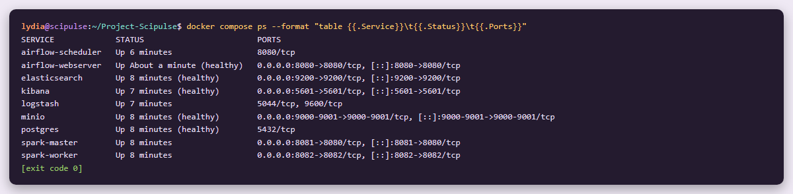
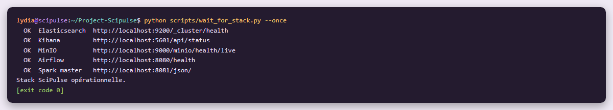
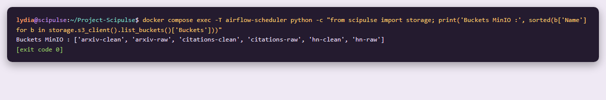
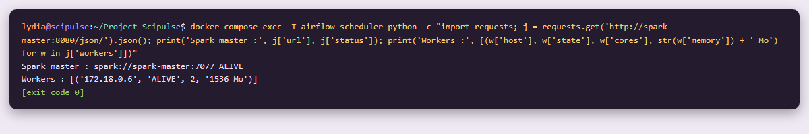
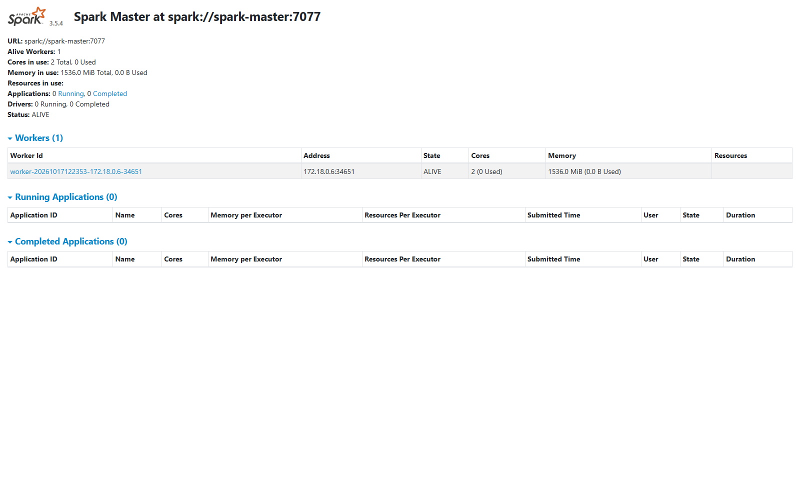
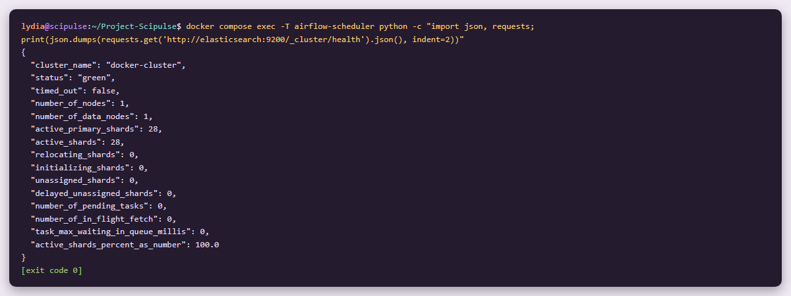
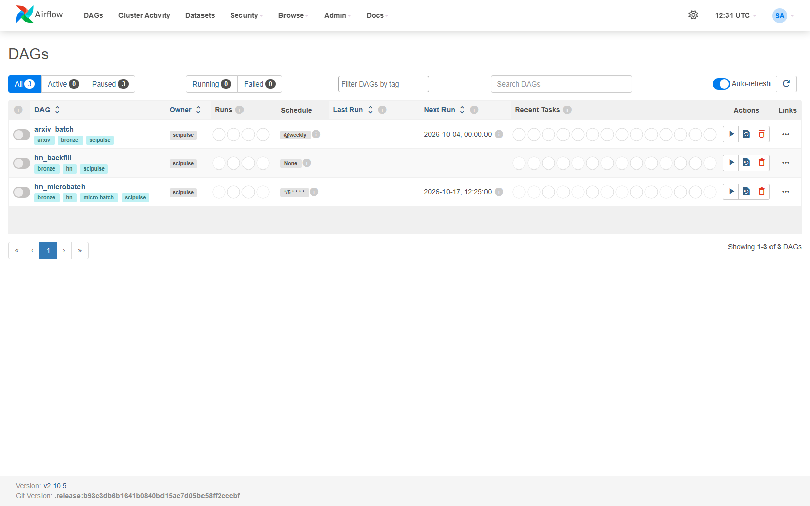
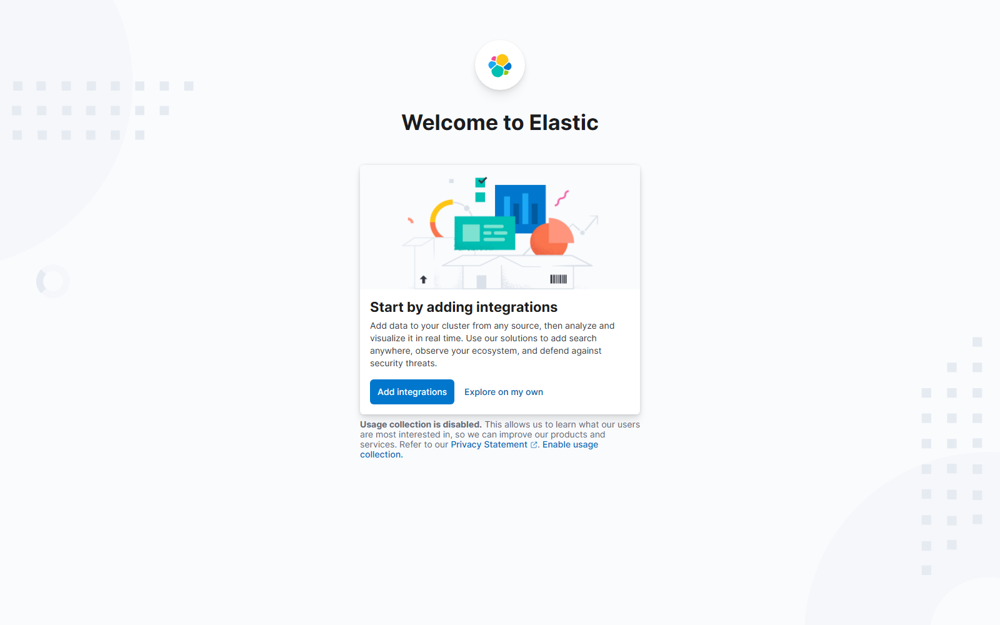

# Étape 1 
# Mise en place de l'infrastructure

**Module 1**

**Lydia Djeghali**

## 1. Taches

- Déployer avec **Docker Compose** : Elasticsearch, Kibana, Logstash, Airflow, MinIO, Spark et PostgreSQL (base d'Airflow).
- Configurer les **connexions entre services**, les **variables d'environnement** et les **secrets**.
- Vérifier la **reproductibilité** : la commande `make up` doit tout démarrer de zéro.

## 2. Architecture

```
┌───────────────── Airflow ─────────────────┐
│  webserver (UI :8080)                     │
│  scheduler (lance les tâches + Spark)     │
└─────┬───────────────┬───────────────┬─────┘
      │               │               │
      ▼               ▼               ▼
 PostgreSQL         MinIO           Spark
 (base Airflow)     data lake       master
                    Bronze/Silver   + worker
                      │               │
                      └───────┬───────┘
                              ▼
 Logstash ──(monitoring)──► Elasticsearch
                            (couche Gold)
                              │
                              ▼
                            Kibana
                            (dashboards)
```

| Service | Rôle | Adresse | Limite mémoire |
|---|---|---|---|
| PostgreSQL | Base de données d'Airflow | interne | 256 Mo |
| MinIO | Data lake ( couches Bronze et Silver ) | API `:9000`, console http://localhost:9001 | 384 Mo |
| Elasticsearch | Couche Gold  | http://localhost:9200 | 1,5 Go (heap 768 Mo) |
| Kibana | Dashboards | http://localhost:5601 | 1 Go |
| Logstash | Envoie les événements du pipeline vers Elasticsearch  | interne | 640 Mo (heap 256 Mo) |
| Spark master | Gestion du cluster Spark | http://localhost:8081 | 512 Mo |
| Spark worker | Exécution des traitements  | http://localhost:8082 | 2 Go |
| Airflow webserver | Interface Airflow | http://localhost:8080 | 1 Go |
| Airflow scheduler | Lance les tâches (et le driver Spark) | interne | 3 Go |
| airflow-init | Prépare Airflow au démarrage, puis s'arrête | — | — |

## 3. Fichiers de l'infrastructure

| Fichier | Contenu |
|---|---|
| `docker-compose.yml` | Les services, leurs ports, volumes, limites mémoire et contrôles de santé |
| `docker/airflow/Dockerfile` | Image commune Airflow + Spark (Python 3.11, Java 17, PySpark 3.5.4) |
| `docker/airflow/requirements.txt` | Librairies Python de l'image |
| `docker/logstash/pipeline/monitoring.conf` | Pipeline Logstash du monitoring |
| `.env.example` | Modèle des variables d'environnement et des secrets |
| `Makefile` | Commandes `make up`, `make down`, `make clean`, `make status` |
| `scripts/make_env.py` | Crée le fichier `.env` (avec une clé de chiffrement Airflow générée) |
| `scripts/wait_for_stack.py` | Attend que tous les services répondent |
| `scripts/setup_elasticsearch.py` | Règle Elasticsearch pour un seul nœud (0 réplique/No yellow state) |
| `scripts/setup_kibana.py` | Règle Kibana (UTC) et importe les dashboards |

## 4. Choix techniques

- **Une seule image pour Airflow et Spark.** Airflow lance les jobs Spark et le worker Spark les exécute : les deux doivent avoir exactement la même version de Python et de PySpark. C'est plus stable de les avoirs donc dans la mème image.
- **Connecteurs Spark inclus dans l'image** : MinIO (`hadoop-aws`) et Elasticsearch (`elasticsearch-spark`, 'elasticsearch-hadoop').
- **LocalExecutor** : un seul serveur, pas besoin de Celery ni de Redis. C'est plus léger.
- **Secrets dans `.env`** : `make up` le crée à partir de `.env.example`.
- **Buckets créés automatiquement** au démarrage de MinIO : `arxiv-raw`, `hn-raw`, `citations-raw`, `arxiv-clean`, `hn-clean`, `citations-clean`.
- **Mémoire limitée** : Docker a été réglé à 6 Go (+ 8 Go de swap) dans `.wslconfig` par manque de mémoire.

## 5. Démarrage

```bash
make up       # crée .env, construit l'image, démarre tout, attend que tout soit prêt.
make status   # affiche l'état des services
make down     # arrête la stack (les données sont gardées)
make clean    # arrête la stack et supprime les données
```

## 6. Vérifications (captures prises à cette étape)

### 6.1 Les services sont démarrés

`docker compose ps` : les 9 services tournent ; ceux qui ont un contrôle de santé sont `healthy`.



### 6.2 Tous les services répondent

Le script `wait_for_stack.py` teste chaque service : **5 sur 5 OK**.



### 6.3 Les buckets MinIO existent

Test lancé **depuis le conteneur Airflow** : il prouve aussi qu'Airflow communique avec MinIO.



### 6.4 Le cluster Spark fonctionne

Le master est `ALIVE` avec 1 worker (2 cœurs, 1,5 Go). Test lancé depuis Airflow.





### 6.5 Elasticsearch est en bonne santé

Test lancé depuis Airflow.



### 6.6 Les interfaces web sont accessibles

**Airflow** : les premiers DAGs sont chargés sans erreur.



**Kibana** :



**Console MinIO** :


## 7. Résultat

| Taches | Statut |
|---|---|
| Stack Docker Compose : Elasticsearch, Kibana, Logstash, Airflow, MinIO, Spark, PostgreSQL | Testé |
| Connexions entre services, variables d'environnement, secrets | Testé |
| `make up` démarre tout de zéro | Testé |

Les problèmes rencontrés et leurs solutions sont décrits dans [Issues/problemes_module1.md](../Issues/problemes_module1.md).
