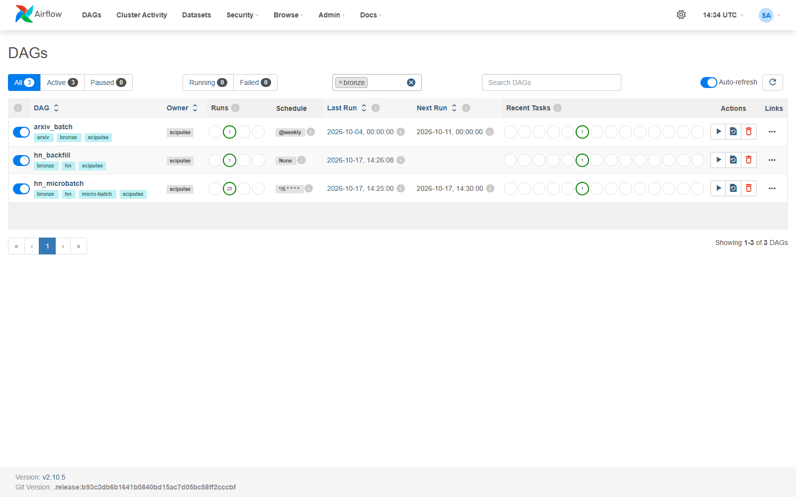
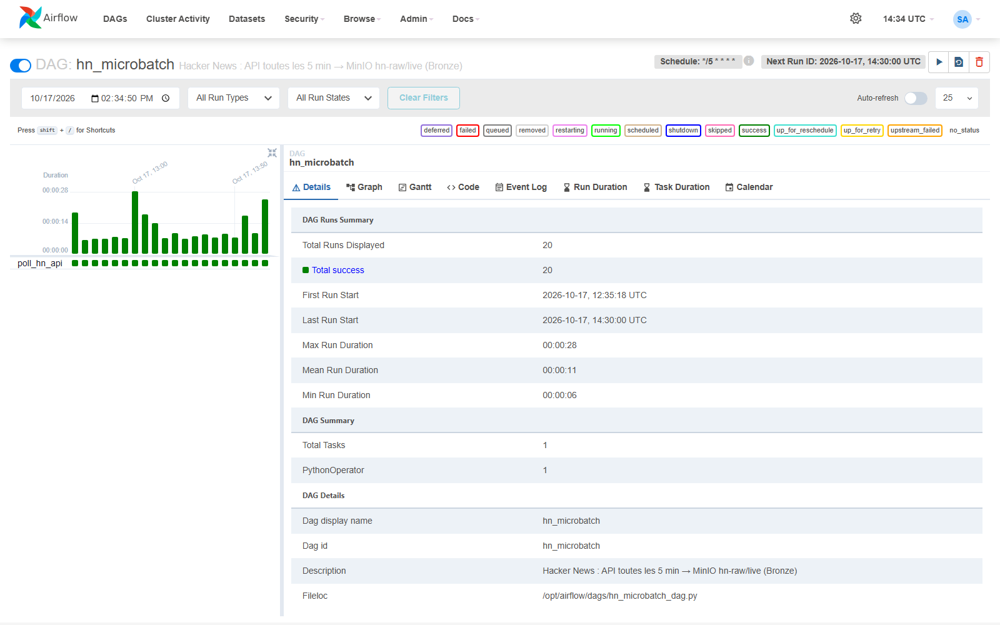
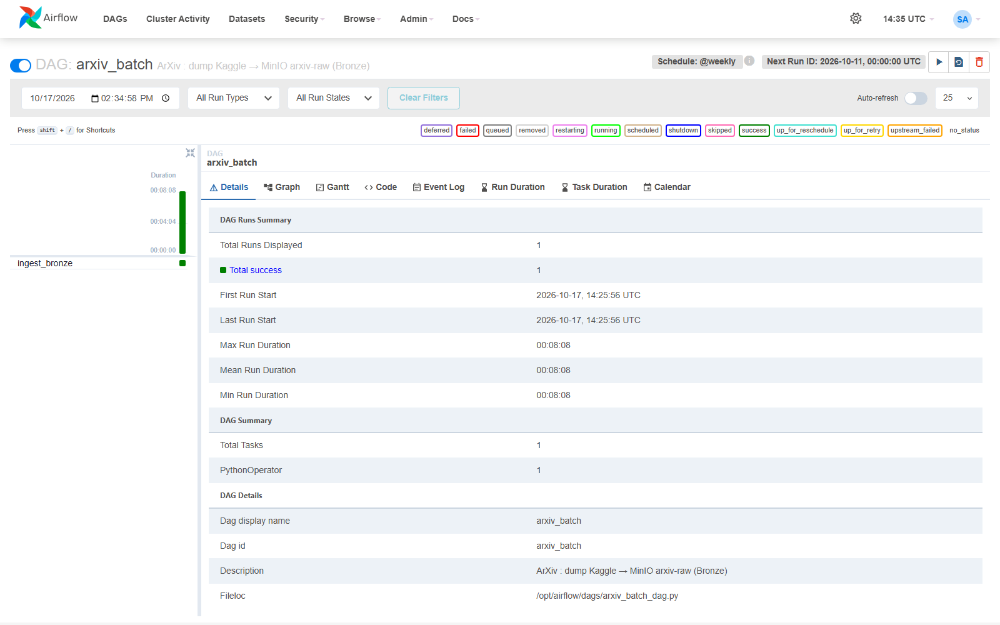
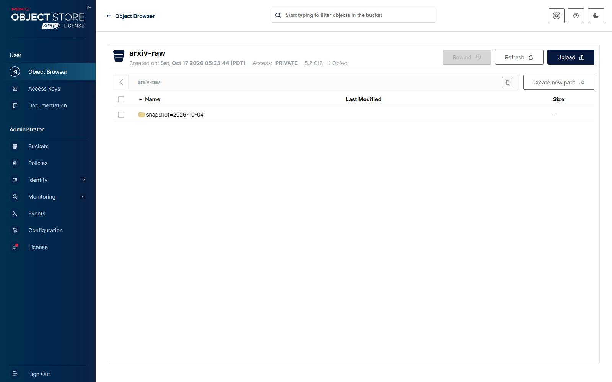
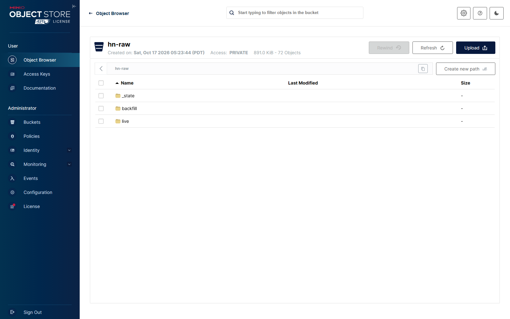

# Étape 2 #
# Couche Bronze : ingestion des données brutes #

**Module 1**

**Lydia Djeghali**

## 1. Taches

- **ArXiv** : un DAG Airflow **batch** qui télécharge le dump JSON et l'écrit **tel quel** dans MinIO (`arxiv-raw/`).
- **Hacker News** : un DAG Airflow de **polling micro-batch toutes les 5 minutes** qui écrit dans MinIO (`hn-raw/`).
- **Aucune transformation** : la couche Bronze est la zone d'atterrissage fidèle à la source, au format **JSON Lines**.

## 2. Ce qui a été mis en place

| Source | DAG Airflow | Fréquence | Destination MinIO |
|---|---|---|---|
| ArXiv (dump Kaggle) | `arxiv_batch` (tâche `ingest_bronze`) | 1 fois par semaine | `arxiv-raw/snapshot=<date>/arxiv-metadata-oai-snapshot.json` |
| Hacker News (API officielle Firebase) | `hn_microbatch` | toutes les 5 minutes | `hn-raw/live/date=<jour>/hn_<heure>_<flux>.jsonl` |
| Hacker News (historique, API Algolia) | `hn_backfill` | une seule fois | `hn-raw/backfill/month=<mois>/…jsonl` |

Code : `src/scipulse/ingestion/arxiv.py`, `src/scipulse/ingestion/hn.py`, `dags/arxiv_batch_dag.py`, `dags/hn_microbatch_dag.py`.

## 3. Choix techniques

- **ArXiv sans copie sur le disque** : le zip Kaggle est lu et envoyé directement vers MinIO, en plusieurs morceaux.
- **Exécution hebdomadaire** : Kaggle met le dump à jour chaque semaine.
- **Hacker News en deux flux** :
  - `live/` : à chaque passage, les **nouvelles stories** depuis le dernier passage, plus les 200 top stories (leur score évolue).
  - `backfill/` : l'**historique des stories qui pointent vers arxiv.org** depuis 2007, via l'API de recherche Algolia (miroir officiel de HN).
- **Contenu non modifié** : la date d'ingestion et le flux sont dans le **nom du fichier**, pas dans les données. Les réponses des API sont écrites telles quelles.
- **Reprise du micro-batch** : le dernier identifiant ingéré est gardé dans `hn-raw/_state/`, pour ne pas recharger les mêmes nouvelles stories.
- **Monitoring** : chaque ingestion écrit un événement (nombre de lignes, durée), envoyé par Logstash dans l'index `scipulse-monitoring`.

## 4. Résultats de la première exécution

| Source | Résultat | Durée |
|---|---|---|
| ArXiv | **3 205 432 articles**, 5,61 Go, 1 fichier | 4,8 min |
| Hacker News — historique | **24 093 stories** pointant vers arxiv.org (2007 -> 2026), 227 fichiers mensuels | 2 min |
| Hacker News — micro-batch | ~200 lignes toutes les 5 minutes | ~5 s par passage |

Vérifications faites à cette étape :

- **ArXiv** : la taille du fichier dans MinIO est égale au nombre d'octets lus dans le zip (5 610 256 780 octets), et toutes les lignes lues sont des JSON valides -> le fichier est complet et non modifié.
- **Hacker News** : une story stockée en Bronze a été relue directement sur l'API ; les champs stables (`id`, `type`, `by`, `time`, `title`, `url`) sont identiques, et aucun champ n'a été ajouté par le pipeline.

## 5. Vérifications

**Airflow / les 3 DAGs Bronze**

**Airflow / le micro-batch Hacker News tourne toutes les 5 minutes**

**Airflow / l'exécution du batch ArXiv**

**MinIO / bucket `arxiv-raw`**

> À cette étape, le snapshot portait la date logique d'Airflow (`2026-10-04`). Il a ensuite été renommé avec la date de publication du fichier Kaggle (`2026-10-11`), voir l'étape Silver.

**MinIO / bucket `hn-raw`** (`live/`, `backfill/`, `_state/`)

## 6. Résultat

| Exigence du brief | Statut |
|---|---|
| DAG Airflow batch ArXiv : dump téléchargé et écrit tel quel dans `arxiv-raw/` | Fait |
| DAG Airflow micro-batch Hacker News toutes les 5 minutes vers `hn-raw/` | Fait |
| Aucune transformation : données fidèles à la source | Fait |
| Format JSON Lines | Fait |

Problèmes rencontrés : [Issues/problemes_module1.md](../Issues/problemes_module1.md).
