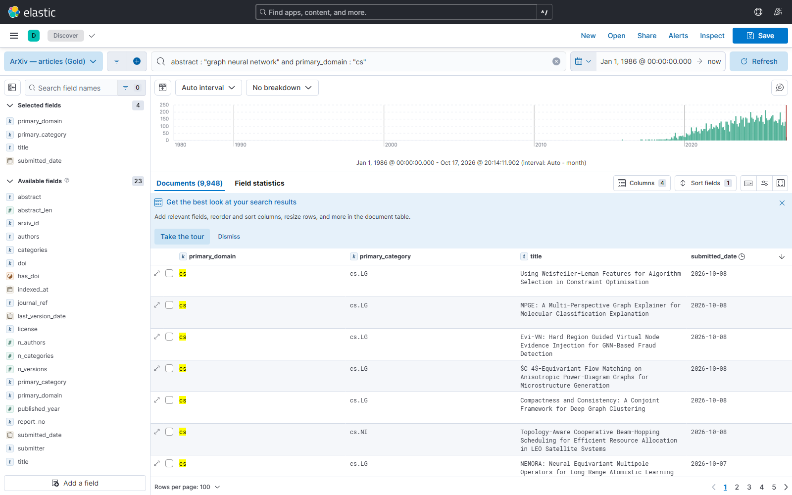
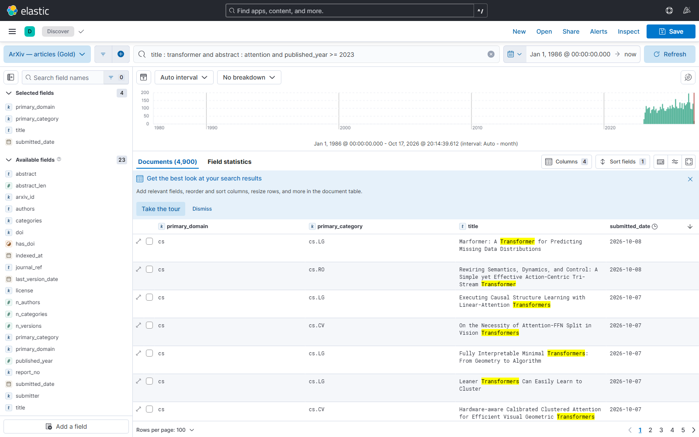
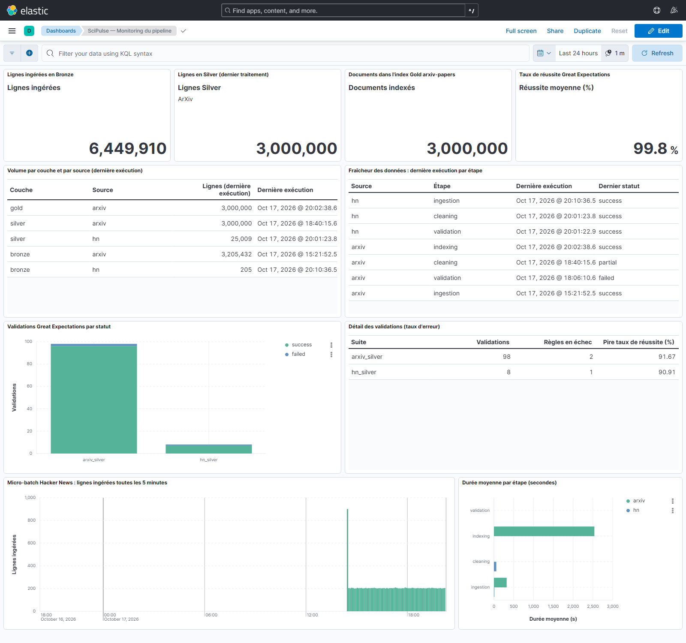
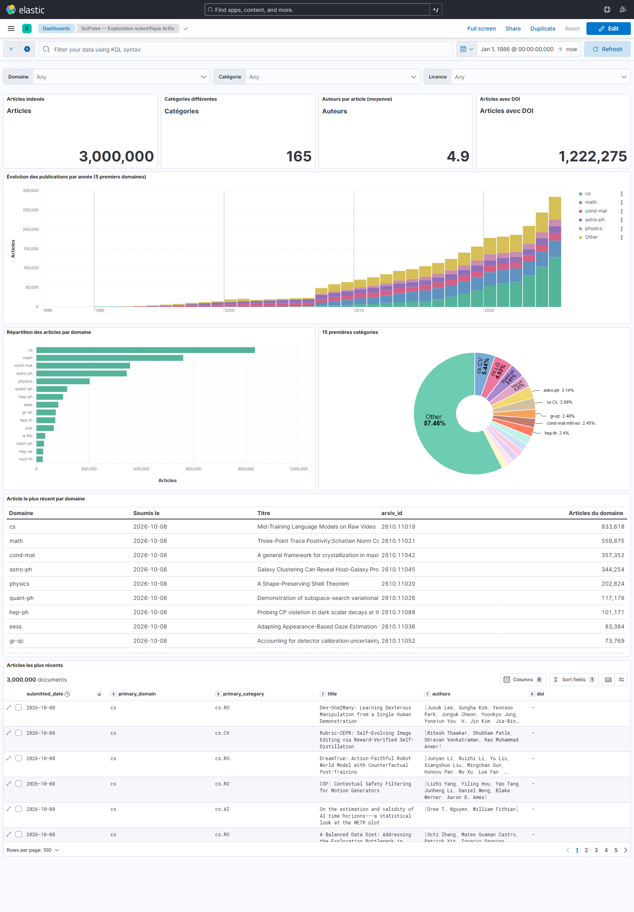
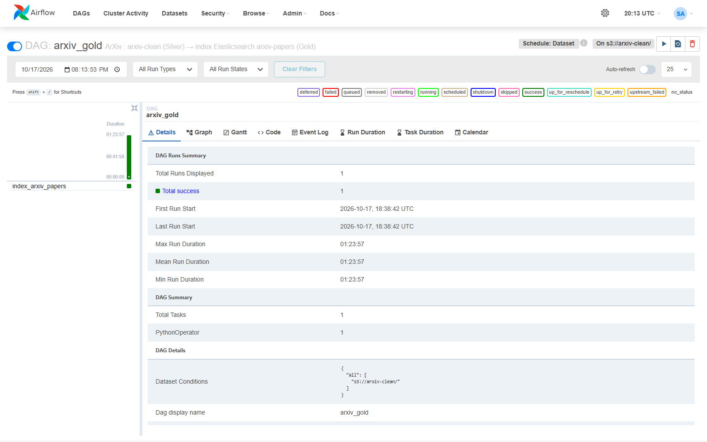

# Étape 4 
# Couche Gold : Elasticsearch et dashboards Kibana

**Module 1**

**Lydia Djeghali**

## 1. Taches

- Définir le **mapping** de l'index `arxiv-papers` : types de champs, analyseurs de texte, choix entre `keyword` et `text`.
- **Indexer les données ArXiv Silver** et valider avec des **requêtes plein texte** et des **agrégations** dans Kibana.
- Un **dashboard de monitoring** du pipeline : volume ingéré par couche, taux d'erreur Great Expectations, fraîcheur des données.
- Un **dashboard d'exploration** scientifique : distribution des catégories, évolution temporelle des publications, articles les plus récents par domaine.

> Au module 1, la couche Gold est **partielle** : seules les données ArXiv sont indexées. La Gold complète (ArXiv + Hacker News + citations) sera produite par Spark au module 2.

## 2. Mapping de l'index `arxiv-papers`

Fichier : `es/mappings/arxiv-papers.json`.

| Champ | Type | Pourquoi |
|---|---|---|
| `title` | `text` (analyseur `scientific_english`) + `title.raw` (`keyword`) | Recherche plein texte / titre exact pour les tableaux |
| `abstract` | `text` (analyseur `scientific_english`) | Recherche plein texte |
| `authors` | `text` + `authors.keyword` | Recherche d'un auteur / top auteurs |
| `arxiv_id`, `doi` | `keyword` | Identifiants : recherche exacte, clés de jointure |
| `categories`, `primary_category`, `primary_domain`, `license` | `keyword` | Filtres et agrégations |
| `submitted_date`, `last_version_date`, `update_date` | `date` (`yyyy-MM-dd`) | Histogrammes dans le temps, tri |
| `n_authors`, `n_categories`, `n_versions`, `published_year`… | nombres | Statistiques |
| `comments` | `text` non indexé | Affiché seulement |

**Analyseur `scientific_english`** : découpage standard, minuscules, suppression des accents, mots vides anglais, et racinisation **légère** (`light_english`). La racinisation légère évite de confondre des termes techniques proches.

**Mode `strict`** : un champ imprévu est refusé au lieu d'être ajouté automatiquement. Le schéma reste donc maîtrisé.

**Réglages** : 1 shard, 0 réplique (un seul nœud ES).

## 3. Indexation

Code : `src/scipulse/indexing/arxiv.py`. DAG : `arxiv_gold`.

- Les 60 fichiers Parquet Silver sont indexés un par un, chacun dans un processus (contole de mémoire).
- L'identifiant de chaque document est son `arxiv_id` : réindexer **remplace** sans créer de doublon.
- Le DAG `arxiv_gold` se **déclenche automatiquement** quand la tâche `clean_silver` met à jour la Silver ArXiv (mécanisme *Dataset* d'Airflow).

| Résultat | |
|---|---|
| Documents indexés | **3 000 000** |
| Erreurs | **0** |
| Taille de l'index | 4,2 Go |
| Santé du cluster | `green` |
| Durée | 84 min |

## 4. Validation : requêtes plein texte et agrégations

| Requête | Résultat |
|---|---|
| Plein texte « graph neural networks » | 10 000+ résultats / en tête : « Graph in Graph Neural Network » |
| Expression exacte « large language model », par année | 86 articles (2021) -> 512 (2022) -> 6 513 (2023) -> 17 848 (2024) -> 28 153 (2025) |
| Agrégation par domaine | cs 833 618, math 559 875, cond-mat 357 352, astro-ph 344 254, physics 202 824 |
| Top catégories en informatique | cs.CV 163 135, cs.LG 147 894, cs.CL 89 561, cs.AI 48 356, cs.RO 45 280 |
| Article le plus récent par domaine | articles du 8 octobre 2026 pour chaque domaine |

**Recherche plein texte dans Kibana (Discover)** : `abstract : "graph neural network" and primary_domain : "cs"` -> **9 948 articles**.

`title : transformer and abstract : attention and published_year >= 2023` :

## 5. Dashboards Kibana

Les dashboards sont **décrits en code** (`scripts/build_kibana.py` -> `kibana/scipulse.ndjson`) et importés par `make up`. Ils sont versionnés et se recréent sans manipulation manuelle.

### 5.1 Monitoring du pipeline

Données : index `scipulse-monitoring`, alimenté par Logstash. Chaque étape du pipeline y écrit un événement : volume, durée, résultat des validations.

| Exigence | Panneau |
|---|---|
| Volume ingéré par couche | Lignes Bronze / Silver / Gold - tableau « volume par couche et par source » |
| Taux d'erreur Great Expectations | Taux de réussite moyen (99,8 %) / validations par statut / détail par suite (règles en échec, pire taux) |
| Fraîcheur des données | Tableau « dernière exécution par étape », avec le dernier statut |
| En plus | Micro-batch HN toutes les 5 minutes / durée moyenne par étape |

### 5.2 Exploration scientifique ArXiv

| Exigence | Panneau |
|---|---|
| Distribution des catégories | Répartition par domaine / 15 premières catégories |
| Évolution temporelle | Publications par année, 5 premiers domaines |
| Articles les plus récents par domaine | Tableau « article le plus récent par domaine » / liste des derniers articles |
| En plus | Filtres Domaine / Catégorie / Licence - recherche plein texte dans la barre de requête / indicateurs (articles, catégories, auteurs, DOI) |

## 6. Orchestration

## 7. Résultat

| Exigence du brief | Statut |
|---|---|
| Mapping `arxiv-papers` (types, analyseurs, keyword / text) | Fait |
| ArXiv Silver indexé, validé par requêtes plein texte et agrégations | Fait (3 000 000 de documents, 0 erreur) |
| Dashboard de monitoring (volume par couche, taux d'erreur GE, fraîcheur) | Fait |
| Dashboard d'exploration (catégories, évolution, articles récents par domaine) | Fait |

Problèmes rencontrés à cette étape : [Issues/problemes_module1.md](../Issues/problemes_module1.md).
