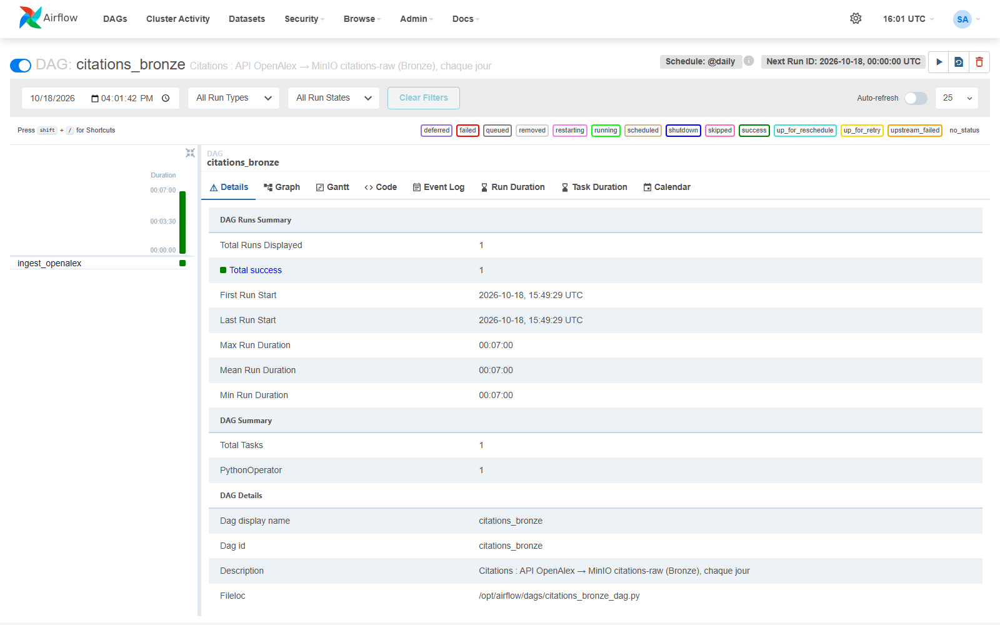
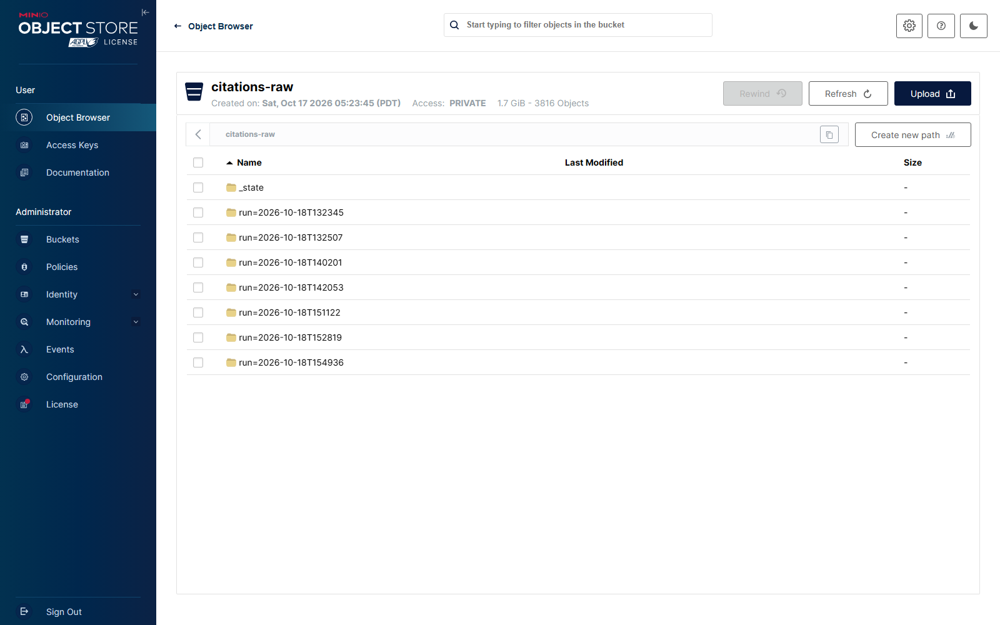
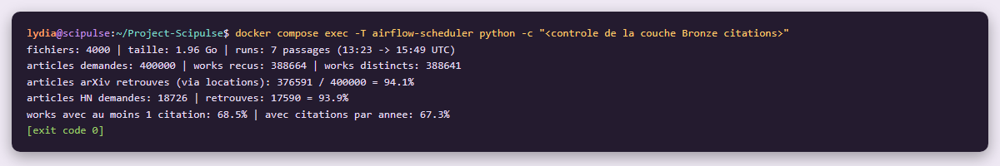

# Étape 1 #
# Couche Bronze : ingestion des citations #

**Module 2**

**Lydia Djeghali**

## 1. Taches

- **Choisir** la source de citations (OpenAlex ou Semantic Scholar).
- Écrire un **script d'ingestion** avec pagination (ou accès bulk) selon l'API choisie.
- Écrire les données **brutes** dans MinIO (`citations-raw/`) au format **JSON Lines** : même logique Bronze qu'au module 1.

## 2. Choix de la source : OpenAlex

| Besoin du module 2 | OpenAlex | Semantic Scholar |
|---|---|---|
| Nombre de citations | `cited_by_count` | `citationCount` |
| **Vélocité de citation**  | **directe** : `counts_by_year` (citations année par année) | non fournie : il faudrait la liste des citations article par article |
| Champ disciplinaire | `primary_topic` (domaine, champ, sous-champ, thème) | `fieldsOfStudy` |
| Références entre articles  | `referenced_works`, dans la même réponse | appels séparés |
| Accès | API REST gratuite, clé gratuite (10 000 requêtes par jour) | API gratuite |

**Raison principale** : OpenAlex donne directement les **citations par année**, nécessaires à la vélocité de citation et au score d'impact.

## 3. Ce qui a été mis en place

| Élément | Détail |
|---|---|
| Code | `src/scipulse/ingestion/openalex.py` |
| DAG Airflow | `citations_bronze` (tâche `ingest_openalex`), **une fois par jour** |
| Destination MinIO | `citations-raw/run=<date-heure>/batch-<n>.jsonl` |
| Déclenchement de la suite | Dataset Airflow `s3://citations-raw` -> déclenche le DAG Silver `citations_silver` |

## 4. Choix techniques

- **Requêtes groupées** : 100 articles par requête, avec un filtre sur leur DOI arXiv (`10.48550/arxiv.<id>`). C'est le maximum accepté par un filtre OpenAlex.
- **Pagination par curseur** (`cursor`) : toutes les pages de résultats d'un lot sont lues.
- **Seuls les champs utiles** sont demandés (`select`) : identifiants, DOI, citations, citations par année, thème, références, liens (`locations`).
- **Réponses écrites telles quelles**, sans modification, comme pour ArXiv et Hacker News.
- **Périmètre : 400 000 articles** (`CITATIONS_MAX_ARTICLES`), à cause du quota journalier de l'API :
  1. d'abord **tous les articles cités sur Hacker News** (pour croiser les trois sources) ;
  2. puis un **échantillon aléatoire reproductible** (graine 42) du reste du corpus. L'aléatoire évite de ne garder que les articles récents, qui ont encore peu de citations.
- **Quota respecté** : arrêt propre sur les réponses 401 / 403 / 429, l'avancement est sauvegardé ; le passage du lendemain reprend où le précédent s'est arrêté.
- **Erreurs réseau** : jusqu'à 5 nouvelles tentatives, avec une attente de plus en plus longue.
- **Monitoring** : chaque passage écrit un événement (articles demandés, works reçus, requêtes, raison de l'arrêt) envoyé par Logstash dans `scipulse-monitoring`.
- **Clé OpenAlex** : dans `.env`, variable `OPENALEX_API_KEY`.

## 5. Résultats

| Résultat | |
|---|---|
| Passages | 7 |
| Fichiers JSON Lines | 4 000 (1,96 Go) |
| Articles  | **400 000** |
| Works OpenAlex reçus | **388 664** (388 641 distincts) |
| Articles arXiv retrouvés | 376 591 / 400 000 = **94,1 %** |
| Articles cités sur HN retrouvés | 17 590 / 18 726 = **93,9 %** |
| Works avec au moins une citation | 68,5 % |

## 6. Vérifications

**Airflow / DAG `citations_bronze`**

**MinIO / bucket `citations-raw`**

**Contrôle de la couche Bronze** : nombre de fichiers, articles demandés et retrouvés, couverture des articles cités sur HN.

## 7. Résultat

| Exigence du brief | Statut |
|---|---|
| Source de citations choisie et justifiée  | Fait  |
| Script d'ingestion avec pagination | Fait |
| Données brutes dans `citations-raw/`, en JSON Lines | Fait |
| Même logique Bronze qu'au module 1 (aucune transformation) | Fait |

