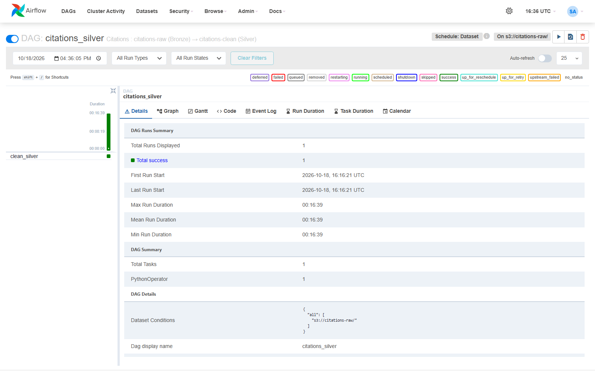
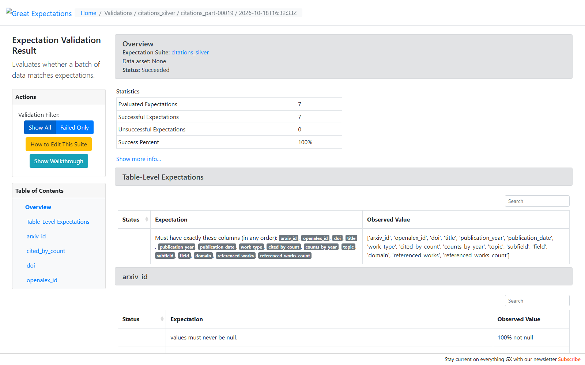
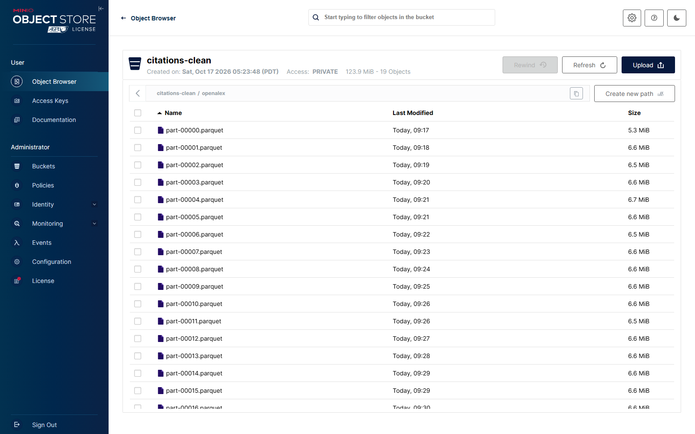
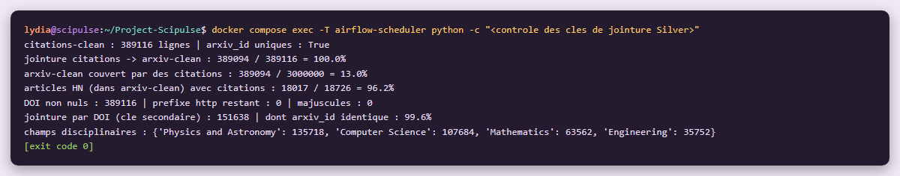

# Étape 2 #
# Couche Silver : nettoyage et normalisation des citations #

**Module 2**

**Lydia Djeghali**

## 1. Taches

- Appliquer une suite **Great Expectations** minimale sur les citations (**au moins 3 expectations**).
- **Normaliser les clés de jointure** : DOI (minuscules, sans préfixe `https://doi.org/`) et identifiant ArXiv. C'est le point de raccordement entre les trois sources.
- Écrire les données nettoyées dans MinIO (`citations-clean/`) au format **Parquet**.

## 2. Ce qui a été mis en place

| Élément | Détail |
|---|---|
| Code | `src/scipulse/cleaning/citations.py` |
| DAG Airflow | `citations_silver`, **déclenché automatiquement** quand `citations_bronze` écrit de nouvelles données (Dataset `s3://citations-raw`) |
| Suite Great Expectations | `citations_silver` (7 expectations), dans `gx/` |
| Destination MinIO | `citations-clean/openalex/part-<n>.parquet` |

## 3. Règles de nettoyage

- **Une ligne par article arXiv** : la clé de jointure commune aux trois sources.
- **Identifiant arXiv retrouvé dans les `locations` d'OpenAlex** : lien `arxiv.org/abs/…`, lien PDF, ou DOI `10.48550/arxiv.<id>`. Il est normalisé **comme pour ArXiv** (même fonction, sans numéro de version).
- **DOI** : minuscules, sans `https://doi.org/` (même fonction que pour ArXiv).
- Un work OpenAlex qui regroupe **plusieurs dépôts arXiv** donne une ligne par identifiant.
- **Doublons** : si un article apparaît dans plusieurs works, on garde celui qui a le plus de citations.
- **Citations par année** gardées en liste (`counts_by_year` : année, nombre) pour la vélocité de citation.
- **Champ disciplinaire** extrait de `primary_topic` : `domain`, `field`, `subfield`, `topic`.
- **Références** (`referenced_works`) et leur nombre, pour l'option C (co-citations).
- Traitement **par paquets de 200 fichiers**.

## 4. Suite Great Expectations `citations_silver`

Chaque paquet est validé **avant** d'être écrit ; un paquet refusé n'est pas écrit.

| Expectation | Règle |
|---|---|
| `expect_table_columns_to_match_set` | Exactement les 15 colonnes attendues |
| `expect_column_values_to_not_be_null` | `arxiv_id` toujours renseigné |
| `expect_column_values_to_be_unique` | `arxiv_id` unique (une ligne par article) |
| `expect_column_values_to_match_regex` | `arxiv_id` au format arXiv (nouveau `2401.12345` ou ancien `hep-th/9901001`) |
| `expect_column_values_to_match_regex` | `doi` normalisé : commence par `10.`, sans majuscules ni espaces |
| `expect_column_values_to_be_between` | `cited_by_count` >= 0 |
| `expect_column_values_to_match_regex` | `openalex_id` au format `W<nombre>` |

## 5. Résultats

| Résultat | |
|---|---|
| Works Bronze lus | 388 664 |
| Lignes Silver écrites | **389 116** (une par article arXiv) |
| Doublons retirés | 188 |
| Works sans identifiant arXiv | 0 |
| Validations Great Expectations | 20 paquets, **7 / 7 expectations réussies** pour chacun |
| Durée | 16,5 min |

**Contrôle des clés de jointure** :

| Contrôle | Résultat |
|---|---|
| `arxiv_id` unique | Oui |
| Citations rattachées à un article de `arxiv-clean` | 389 094 / 389 116 = **100,0 %** |
| Articles de `arxiv-clean` avec des citations | 389 094 / 3 000 000 = 13,0 %  |
| Articles cités sur HN avec des citations | 18 017 / 18 726 = **96,2 %** |
| DOI : préfixe `http` restant / majuscules | 0 / 0 |
| Jointure par DOI (clé secondaire) | 151 638 lignes, `arxiv_id` identique à 99,6 % |
| Champs disciplinaires principaux | Physics and Astronomy 135 718, Computer Science 107 684, Mathematics 63 562, Engineering 35 752 |

## 6. Vérifications

**Airflow / DAG `citations_silver`**

**Great Expectations / Data Docs de la suite `citations_silver`**

**MinIO / bucket `citations-clean`**

**Contrôle des clés de jointure**

## 7. Résultat

| Exigence | Statut |
|---|---|
| Suite Great Expectations sur les citations (au moins 3 expectations) | Fait  |
| DOI normalisé (minuscules, sans `https://doi.org/`) | Fait |
| Identifiant ArXiv normalisé (même format que `arxiv-clean`) | Fait  |
| Données nettoyées dans `citations-clean/`, en Parquet | Fait |

