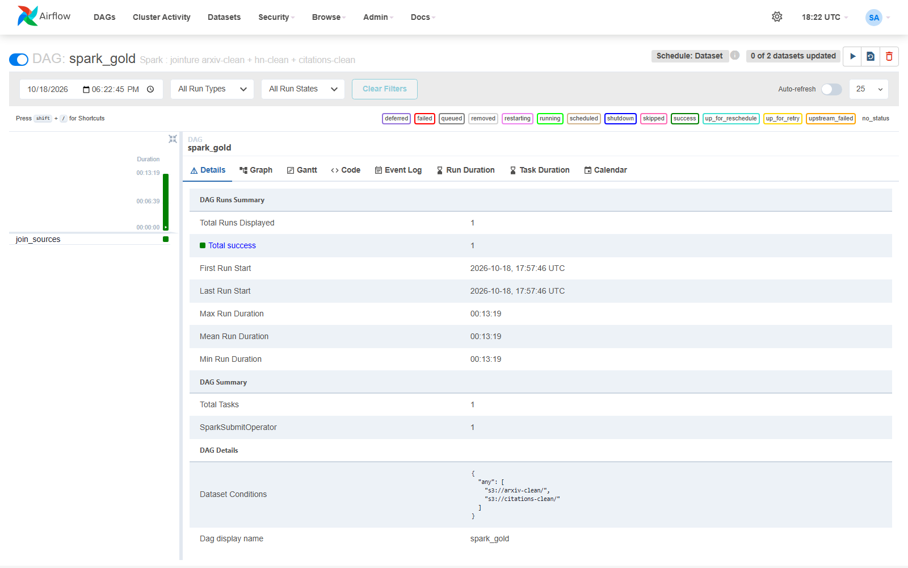
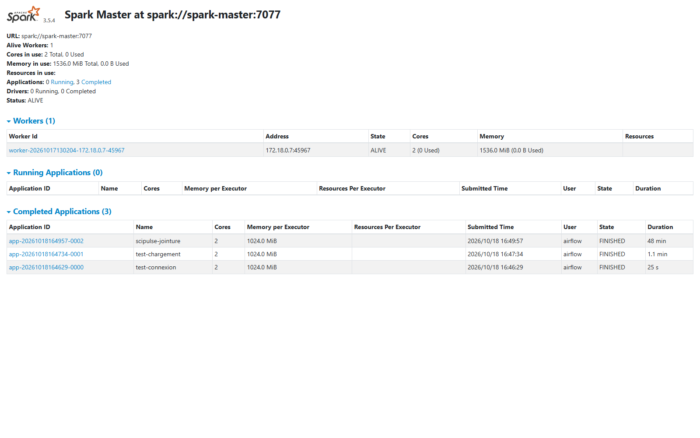
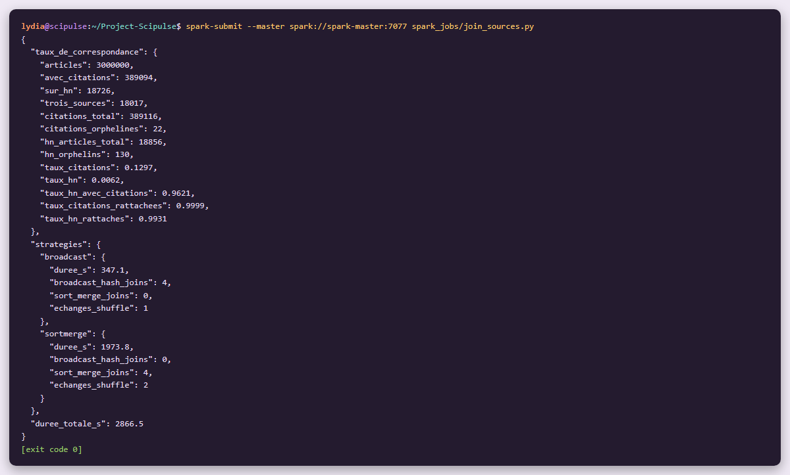
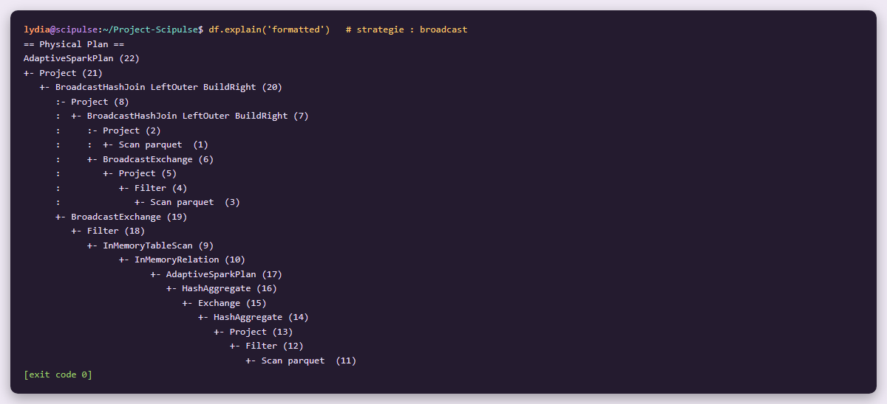
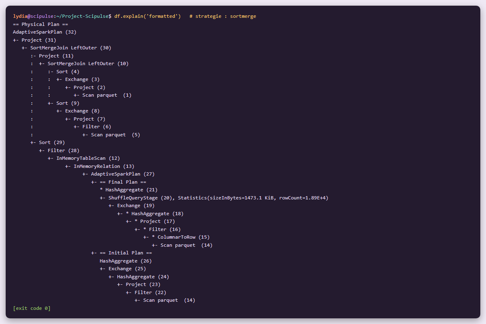

# Étape 3 #
# Spark : jointure des trois sources #

**Module 2**

**Lydia Djeghali**

## 1. Taches

- Charger les **trois couches Silver** depuis MinIO dans des DataFrames PySpark (`arxiv-clean/`, `hn-clean/`, `citations-clean/`).
- Implémenter la **jointure à trois sources** et analyser le **taux de correspondance** (match coverage).
- **Comparer et justifier** la stratégie de jointure (broadcast join ou sort-merge join) en lisant le plan d'exécution.

## 2. Ce qui a été mis en place

| Élément | Détail |
|---|---|
| Chargement des 3 Silver | `src/scipulse/spark/sources.py` (lecture Parquet sur MinIO via `s3a://`) |
| Jointure et taux de correspondance | `src/scipulse/spark/joins.py` |
| Job Spark | `spark_jobs/join_sources.py` (`--compare` : compare les deux stratégies) |
| Orchestration | DAG `spark_gold` (`SparkSubmitOperator`), déclenché quand la Silver ArXiv **ou** la Silver citations est mise à jour |
| Résultats | `logs/spark/join_report.json`, plans d'exécution `logs/spark/plan_broadcast.txt` et `plan_sortmerge.txt` |

## 3. La jointure

- **Table centrale : les articles ArXiv** (3 000 000). Les deux autres sources y sont rattachées par **`arxiv_id`**, la clé normalisée à l'étape Silver.
- **Jointures externes à gauche** : on garde **tous** les articles, même sans citations ni passage sur HN. C'est indispensable pour les cas d'usage du dashboard (« très cités mais jamais sur HN »).
- **Hacker News regroupé par article** avant la jointure : plusieurs stories peuvent pointer vers le même article. On garde le nombre de stories, la somme et le maximum des points, la somme des commentaires, la première et la dernière apparition.
- Deux indicateurs par article : `has_citations` et `on_hn`.
- **Seules les colonnes utiles** sont lues dans les fichiers Parquet ArXiv.

## 4. Taux de correspondance

| Mesure | Résultat |
|---|---|
| Articles ArXiv (Silver) | 3 000 000 |
| Articles avec citations | **389 094** (13,0 %) |
| Articles cités sur HN | **18 726** (0,6 %) |
| Articles présents dans **les trois sources** | **18 017**, soit **96,2 %** des articles cités sur HN |
| Citations rattachées à un article | 389 094 / 389 116 = **99,99 %** (22 orphelines) |
| Articles HN rattachés à un article | 18 726 / 18 856 = **99,3 %** (130 orphelins) |

## 5. Stratégie de jointure : broadcast

La même jointure a été exécutée avec les deux stratégies (`--compare`) :

| Stratégie | Durée | Plan d'exécution |
|---|---|---|
| **Broadcast join** | **347 s** | `BroadcastHashJoin` : les citations et les stories HN sont envoyées à chaque exécuteur ; les 3 M d'articles ne bougent pas |
| Sort-merge join | 1 974 s | `SortMergeJoin` : les deux côtés sont redistribués (`Exchange hashpartitioning`) puis triés sur `arxiv_id` |

**Choix : broadcast join, 5,7 fois plus rapide.**

- Les tables rattachées sont **petites** : 389 116 lignes de citations (colonnes utiles seulement) et 18 856 articles HN. Elles tiennent en mémoire sur chaque exécuteur.
- La grande table (3 M d'articles) n'est **ni redistribuée ni triée**.
- Le sort-merge join n'est utile que quand **les deux** tables sont trop grandes pour être diffusées.

## 6. Vérifications

**Airflow / DAG `spark_gold`** (à cette étape, une seule tâche : `join_sources`)

**Spark / interface du master pendant le job**

**Rapport de la jointure** : taux de correspondance et comparaison des stratégies.

**Plan d'exécution : broadcast join**

**Plan d'exécution : sort-merge join**

## 7. Résultat

| Exigence| Statut |
|---|---|
| Les 3 couches Silver chargées dans des DataFrames PySpark | Fait |
| Jointure à trois sources | Fait |
| Taux de correspondance analysé | Fait |
| Stratégie de jointure comparée et justifiée avec le plan d'exécution | Fait |

