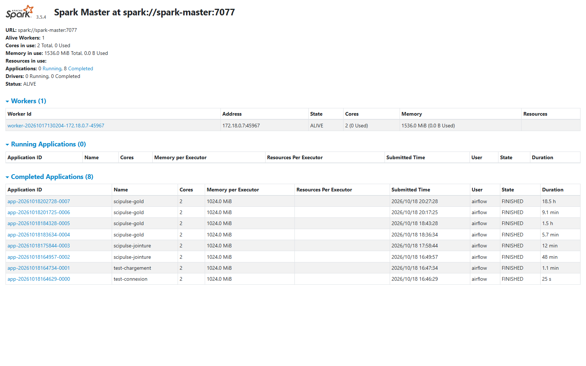
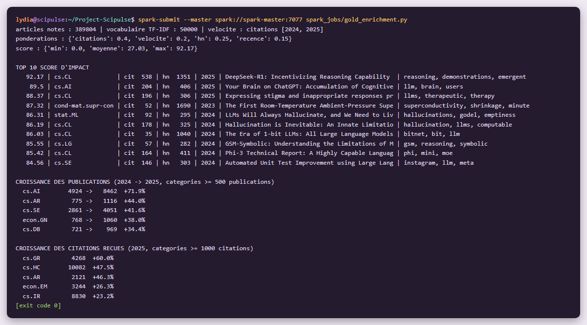

# Étape 4 #
# Spark : analytique avancée et score d'impact #

**Module 2**

**Lydia Djeghali**

## 1. Taches

- Calculer des **indicateurs temporels par catégorie** : croissance annuelle des publications, vélocité de citation (**window functions** Spark).
- Implémenter un pipeline **TF-IDF distribué** (Spark MLlib) sur les résumés ArXiv.
- Construire un **score d'impact composite** combinant au minimum : citations académiques, signal Hacker News  et indicateur de **récence**. Documenter et justifier les pondérations.

## 2. Ce qui a été mis en place

| Élément | Détail |
|---|---|
| Indicateurs, TF-IDF, score | `src/scipulse/spark/analytics.py` |
| Job Spark | `spark_jobs/gold_enrichment.py` |
| Rapport | `logs/spark/gold_report.json` |
| Périmètre du score | articles **avec citations OpenAlex et/ou cités sur HN** : 389 805 articles |

Le score n'est calculé que pour les articles qui ont au moins un signal (citations ou HN) : sans citations ni passage sur HN, il ne refléterait que la récence.

## 3. Indicateurs temporels par catégorie (window functions)

**Croissance annuelle des publications** (corpus ArXiv complet, 3 M d'articles) :
nombre de publications par catégorie et par année, puis comparaison avec l'année précédente par `lag()` sur une fenêtre `partitionBy(primary_category).orderBy(published_year)`.

**Vélocité de citation** :

- **par article** : citations reçues pendant les **2 dernières années complètes** (2024 et 2025), divisées par 2, à partir de `counts_by_year` ;
- **par catégorie** : citations reçues par année (`explode` de `counts_by_year`), puis croissance d'une année sur l'autre avec `lag()` sur la même fenêtre.

| Croissance des publications 2024 -> 2025 (catégories >= 500 publications) | | Croissance des citations reçues en 2025 (catégories >= 1 000 citations) | |
|---|---|---|---|
| cs.AI | +71,9 % | cs.GR | +60,0 % |
| cs.AR | +44,0 % | cs.HC | +47,5 % |
| cs.SE | +41,6 % | cs.AR | +46,3 % |
| econ.GN | +38,0 % | econ.EM | +26,3 % |
| cs.DB | +34,4 % | cs.IR | +23,2 % |

## 4. TF-IDF distribué (Spark MLlib)

Pipeline MLlib sur les résumés des 389 805 articles :

| Étape | Réglage |
|---|---|
| `RegexTokenizer` | mots de lettres uniquement, 3 caractères minimum |
| `StopWordsRemover` | mots vides anglais |
| `CountVectorizer` | vocabulaire de **50 000** termes, présents dans au moins **5** résumés |
| `IDF` | pondération inverse de la fréquence dans les documents |

Résultat : les **5 termes au plus fort poids TF-IDF** de chaque article, dans le champ `mots_cles` (par exemple « reasoning, demonstrations, emergent » pour DeepSeek-R1).

## 5. Score d'impact composite

**score = 100 × (0,40·C + 0,20·V + 0,25·H + 0,15·R)**, chaque composante entre 0 et 1.

| Composante | Calcul | Poids | Justification |
|---|---|---|---|
| **C** : citations académiques | rang percentile des citations **dans sa cohorte** (même domaine, même année de publication) | **40 %** | Le signal de référence de l'impact scientifique, donc le poids le plus fort. Le rang dans la cohorte évite de comparer un article de 2024 à un article de 2010, ou les mathématiques à l'informatique (habitudes de citation très différentes). |
| **V** : vélocité de citation | rang percentile de la vélocité dans son domaine | **20 %** | Mesure l'élan **actuel** : un article encore très cité aujourd'hui pèse plus qu'un article cité il y a longtemps. Complète C sans le dupliquer. |
| **H** : signal Hacker News | `log(1 + points + commentaires)`, divisé par le maximum ; 0 si jamais sur HN | **25 %** | l'écho dans la communauté tech. **Échelle logarithmique** car la distribution est très inégale (de 1 à plus de 1 600 points)  |
| **R** : récence | `exp(-âge / 3 ans)` | **15 %** | un article récent n'a pas encore eu le temps d'être cité. Décroissance douce : 0,72 à 1 an, 0,37 à 3 ans. |

Les poids font 100 % : le score va de 0 à 100. Les composantes de chaque article (`score_citations`, `score_velocite`, `score_hn`, `score_recence`) sont gardées dans l'index pour expliquer chaque score.

**Résultats** : score minimum 0, moyenne **27,0**, maximum **92,2**.

| Score | Article | Catégorie | Citations | Points HN |
|---|---|---|---|---|
| 92,17 | DeepSeek-R1: Incentivizing Reasoning Capability in LLMs via Reinforcement Learning | cs.CL | 538 | 1 351 |
| 89,50 | Your Brain on ChatGPT: Accumulation of Cognitive Debt… | cs.AI | 204 | 406 |
| 88,37 | Expressing stigma and inappropriate responses prevents LLMs from safely replacing mental health providers | cs.CL | 196 | 306 |
| 87,32 | The First Room-Temperature Ambient-Pressure Superconductor | cond-mat.supr-con | 52 | 1 690 |
| 86,31 | LLMs Will Always Hallucinate, and We Need to Live With This | stat.ML | 92 | 295 |

Le haut du classement combine bien les deux signaux : articles récents, cités par la recherche **et** très discutés sur HN.

## 6. Vérifications

**Spark / interface du master pendant le calcul**

**Rapport du job** : pondérations, statistiques du score, top 10, croissance des publications et des citations par catégorie.

> À ce premier calcul, 389 804 articles étaient notés. Le calcul final (étape 5) en note 389 805 : les données Hacker News, alimentées toutes les 5 minutes, ont évolué entre les deux calculs (18 726 puis 18 728 articles cités sur HN).

## 7. Résultat

| Exigence  | Statut |
|---|---|
| Croissance annuelle des publications par catégorie (window functions) | Fait |
| Vélocité de citation (window functions) | Fait  |
| TF-IDF distribué (Spark MLlib) sur les résumés | Fait  |
| Score composite : citations + HN (log) + récence | Fait|
| Pondérations documentées et justifiées | Fait |

