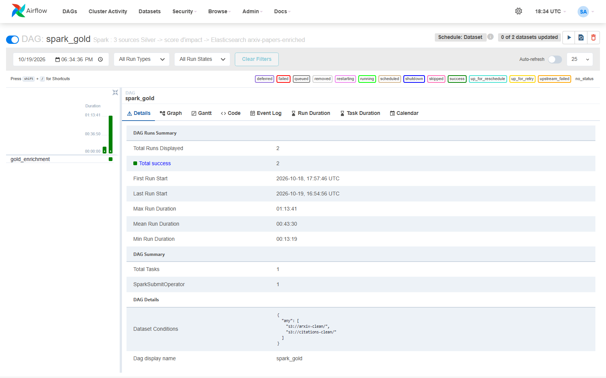
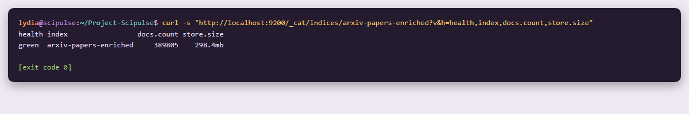
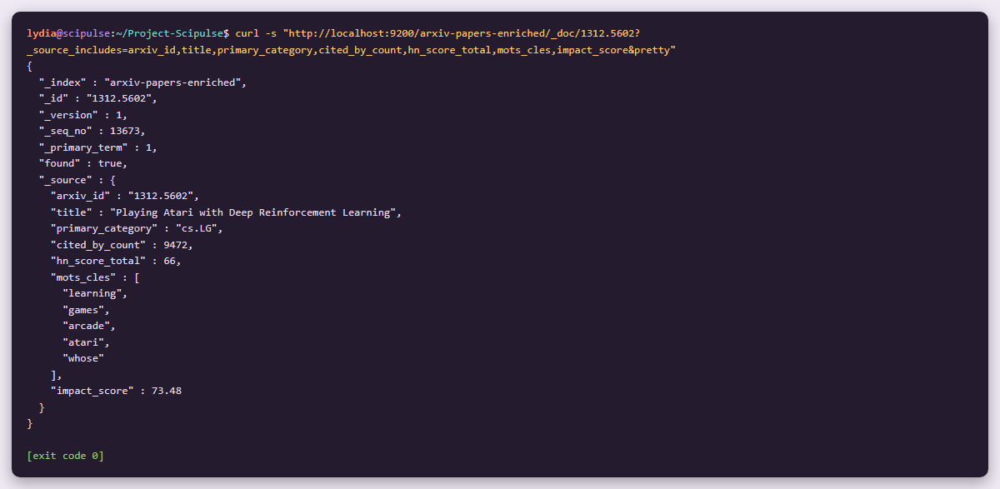
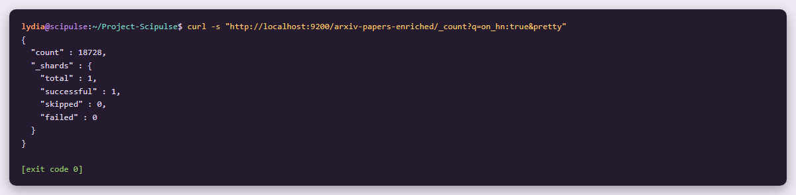

# Étape 5 #
# Couche Gold : écriture Elasticsearch et intégration Airflow #

**Module 2**

**Lydia Djeghali**

## 1. Taches

- Écrire le DataFrame enrichi dans l'index Elasticsearch **`arxiv-papers-enriched`** avec le connecteur **elasticsearch-hadoop**. C'est la seule écriture vers Elasticsearch du module 2, et elle constitue la **couche Gold finale**.
- **Intégrer la tâche Spark dans Airflow** (`SparkSubmitOperator`), pour que le pipeline Bronze -> Silver -> Gold soit orchestré de bout en bout.

## 2. Ce qui a été mis en place

| Élément | Détail |
|---|---|
| Mapping de l'index | `es/mappings/arxiv-papers-enriched.json` (mode `strict`) |
| Écriture Elasticsearch | `src/scipulse/spark/gold.py` |
| Job Spark | `spark_jobs/gold_enrichment.py` (`--publish-only` : republier sans recalculer) |
| DAG Airflow | `spark_gold`, tâche `gold_enrichment` (`SparkSubmitOperator`) |
| Résultat intermédiaire | Parquet dans le bucket technique `gold-staging` |

## 3. Mapping de l'index `arxiv-papers-enriched`

| Groupe de champs | Champs | Type |
|---|---|---|
| Article ArXiv | `arxiv_id`, `title` (+ `title.raw`), `authors`, `categories`, `primary_category`, `primary_domain`, `doi`, `submitted_date`, `published_year` | `keyword`, `text` (analyseur `scientific_english`, comme au module 1), `date` |
| Citations OpenAlex | `openalex_id`, `cited_by_count`, `counts_by_year` (année, citations), `topic`, `subfield`, `field`, `domain`, `referenced_works_count`, `velocite_citations` | nombres, `keyword` |
| Hacker News | `hn_stories`, `hn_score_total`, `hn_score_max`, `hn_comments_total`, `hn_first_seen`, `hn_last_seen` | nombres, `date` |
| Indicateurs | `has_citations`, `on_hn`, `mots_cles` (TF-IDF) | `boolean`, `keyword` |
| Score d'impact | `score_citations`, `score_velocite`, `score_hn`, `score_recence`, `impact_score` | `float` |

- **Mode `strict`** : un champ imprévu est refusé, le schéma reste maîtrisé.
- **Identifiant du document = `arxiv_id`** : republier **remplace** les documents, sans doublon.
- L'index est créé avec son mapping **avant** l'écriture (`es.index.auto.create = false`).

## 4. Écriture avec elasticsearch-hadoop

- Le connecteur `elasticsearch-spark-30_2.12` (8.15.3) est **inclus dans l'image** Spark.
- Chaque ligne est **sérialisée en JSON par Spark** (`to_json`), puis envoyée telle quelle par le connecteur (`es.input.json`). Le connecteur ne sait pas convertir seul les tableaux d'objets comme `counts_by_year`.
- Envoi par lots de 2 000 documents.
- Le résultat du score est d'abord écrit en **Parquet dans `gold-staging`**, puis publié : en cas d'échec de l'écriture Elasticsearch, on republie sans refaire les calculs (`--publish-only`).

## 5. Intégration Airflow

```
citations_bronze (quotidien) -> citations_silver ─┐
arxiv_batch (hebdomadaire) -> clean_silver ───────┴─> spark_gold -> Elasticsearch arxiv-papers-enriched
```

| Réglage du DAG `spark_gold` | Valeur |
|---|---|
| Déclenchement | **Datasets Airflow** : dès que `arxiv-clean` **ou** `citations-clean` est mis à jour |
| Opérateur | `SparkSubmitOperator`, connexion `spark_default` (`spark://spark-master:7077`) |
| Délai maximum | 4 h |

## 6. Résultats

Exécution complète par le DAG `spark_gold`.

| Résultat | |
|---|---|
| Documents indexés | **389 805** |
| Santé de l'index | `green` |
| Taille | 298,4 Mo |
| Durée de l'écriture Elasticsearch | 342 s |
| Articles cités sur HN | 18 728 |
| Articles avec citations | 389 094 |

## 7. Vérifications

**Airflow / DAG `spark_gold`** : 2 exécutions réussies (jointure seule à l'étape 3, puis le calcul complet avec écriture Gold).



**État de l'index** :



**Un document de l'index** : « Playing Atari with Deep Reinforcement Learning », lu par son `arxiv_id`, avec ses citations, son signal HN, ses mots-clés TF-IDF et son score d'impact.



**Requête de comptage** : articles cités sur Hacker News.



## 8. Résultat

| Exigence| Statut |
|---|---|
| DataFrame enrichi écrit dans `arxiv-papers-enriched` avec elasticsearch-hadoop | Fait |
| Seule écriture vers Elasticsearch, couche Gold finale | Fait |
| Tâche Spark intégrée dans Airflow (`SparkSubmitOperator`) | Fait  |
| Pipeline Bronze -> Silver -> Gold orchestré de bout en bout | Fait ) |

