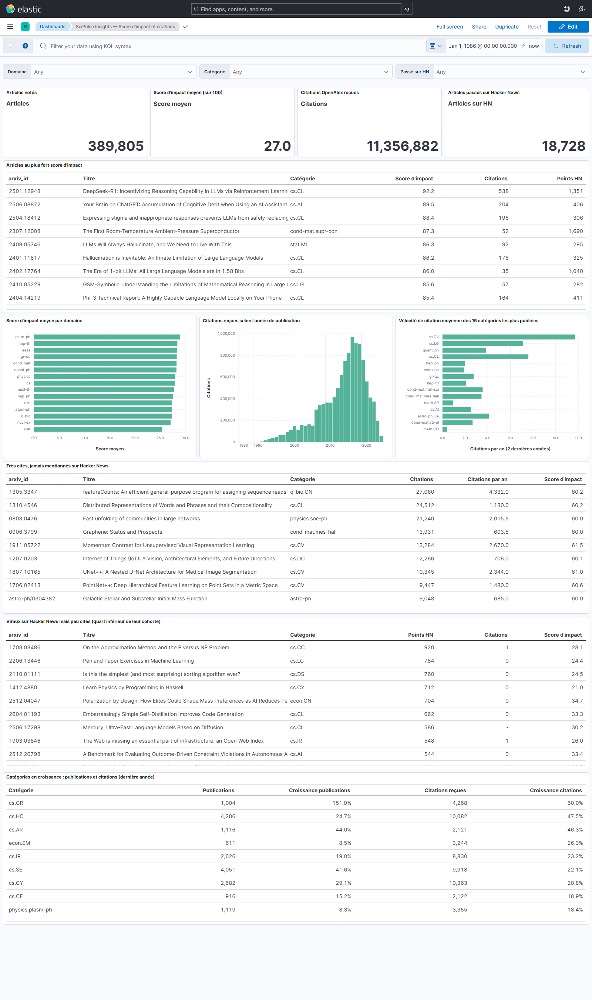

# Étape 6 #
# Dashboard Kibana augmenté (Gold complet) #

**Module 2**

**Lydia Djeghali**

## 1. Taches

Mettre à jour le dashboard Kibana pour exposer le **score d'impact composite**, les **indicateurs de citation** et des **cas d'usage analytiques démontrables**, par exemple :

- articles très cités académiquement mais jamais mentionnés sur Hacker News ;
- articles viraux sur Hacker News mais peu cités dans la littérature ;
- sous-domaines en croissance rapide selon les deux métriques combinées.

## 2. Ce qui a été mis en place

| Élément | Détail |
|---|---|
| Dashboard | **« SciPulse Insights : Score d'impact et citations »** |
| Données | index Gold `arxiv-papers-enriched` (vue de données « ArXiv enrichi : score d'impact (Gold) ») |
| Code | `scripts/build_kibana.py` -> `kibana/scipulse.ndjson`, importé par `make up` comme les dashboards du module 1 |
| Filtres | Domaine, Catégorie, Passé sur HN et recherche dans la barre de requête |

## 3. Indicateurs de catégorie ajoutés à l'index

Le cas d'usage 3 compare des **catégories**, alors que l'index contient des **articles**. Les croissances par catégorie calculées par Spark à l'étape 4 sont donc ajoutées à chaque article, au moment de la publication Gold :

| Champ | Contenu  |
|---|---|
| `publications_categorie` | publications de la catégorie dans l'année |
| `croissance_publications_categorie` | croissance par rapport à l'année précédente |
| `citations_categorie` | citations reçues par les articles de la catégorie dans l'année |
| `croissance_citations_categorie` | croissance par rapport à l'année précédente |

## 4. Contenu du dashboard

| Exigence | Panneaux |
|---|---|
| **Score d'impact composite** | Score moyen (27,0 / 100), articles au plus fort score , score moyen par domaine |
| **Indicateurs de citation** | Citations OpenAlex reçues (11,4 M) : citations selon l'année de publication , vélocité de citation des 15 catégories les plus publiées |
| **Signal Hacker News** | Articles passés sur HN (18 728) : points HN dans les tableaux |
| Volume | Articles notés (389 805) |

### Cas d'usage 1 : très cités, jamais mentionnés sur Hacker News

Requête : `on_hn : false`, triée par nombre de citations.

| Article | Catégorie | Citations |
|---|---|---|
| featureCounts: an efficient general-purpose program for assigning sequence reads… | q-bio.GN | 27 060 |
| Distributed Representations of Words and Phrases and their Compositionality | cs.CL | 24 512 |
| Fast unfolding of communities in large networks | physics.soc-ph | 21 240 |

### Cas d'usage 2 : viraux sur Hacker News, peu cités

Requête : `on_hn : true and score_citations < 0.25`, triée par points HN.
« Peu cités » = dans le **quart inférieur de leur cohorte** (même domaine, même année) : un seuil fixe désavantagerait les articles récents.

| Article | Catégorie | Points HN | Citations |
|---|---|---|---|
| On the Approximation Method and the P versus NP Problem | cs.CC | 920 | 1 |
| Pen and Paper Exercises in Machine Learning | cs.LG | 784 | 0 |
| Is this the simplest (and most surprising) sorting algorithm ever? | cs.DS | 760 | 0 |

### Cas d'usage 3 : catégories en croissance selon les deux métriques

Requête : croissance des publications **et** des citations positives, catégories d'au moins 500 publications dans l'année, triée par croissance des citations.

| Catégorie | Publications 2025 | Croissance publications | Croissance citations |
|---|---|---|---|
| cs.GR (graphisme) | 1 004 | +151,0 % | +60,0 % |
| cs.HC (interaction homme-machine) | 4 286 | +24,7 % | +47,5 % |
| cs.AR (architecture matérielle) | 1 116 | +44,0 % | +46,3 % |
| cs.SE (génie logiciel) | 4 051 | +41,6 % | +22,1 % |

## 5. Vérification

**Dashboard « SciPulse Insights : Score d'impact et citations »**

## 6. Résultat

| Exigence | Statut |
|---|---|
| Score d'impact composite exposé | Fait |
| Indicateurs de citation exposés | Fait  |
| Très cités, jamais sur Hacker News | Fait |
| Viraux sur Hacker News, peu cités | Fait |
| Sous-domaines en croissance selon les deux métriques | Fait |

