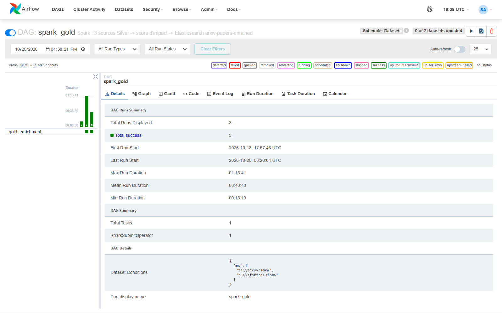
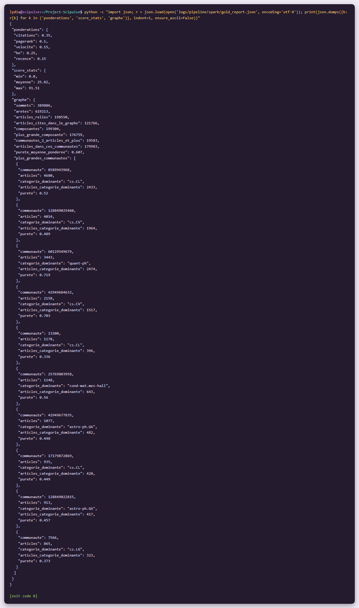
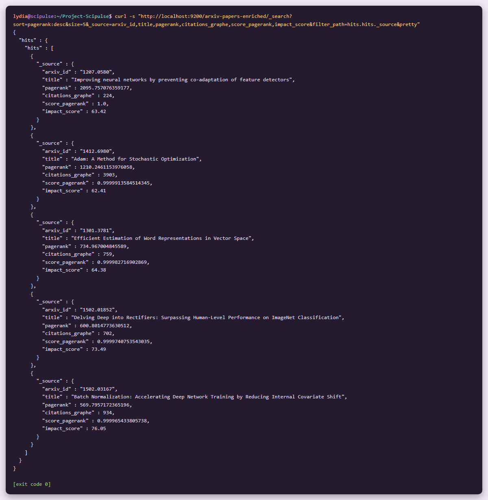
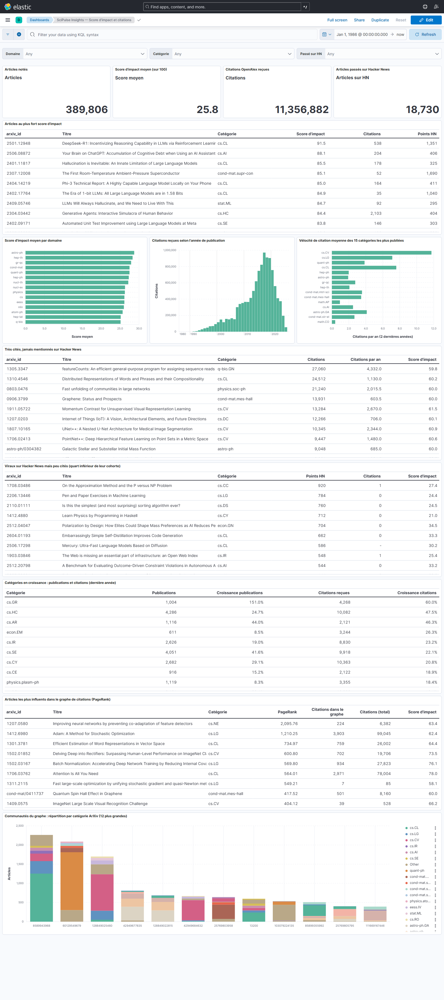

# Graphe de citations et PageRank (GraphFrames) #

**Extension optionnelle**

**Lydia Djeghali**

## 1. Taches

- Construire le **graphe de citations** à partir des données Silver : chaque article est un sommet (identifiant arXiv), chaque référence une arête orientée.
- Calculer le **PageRank** des articles et l'intégrer comme **dimension supplémentaire du score d'impact**.
- Identifier les **composantes connexes** et les **communautés thématiques**, et les comparer avec les catégories ArXiv.
- Ajouter le PageRank à l'index Gold et l'**exposer dans Kibana**.

## 2. Pourquoi l'option B

Les trois options du brief ont été comparées sur nos données :

| Option | Constat |
|---|---|
| A — Streaming | Un job Spark permanent occuperait l'unique worker (2 cœurs) et ralentirait le job Gold. |
| **B — Graphe et PageRank** | **renforce directement le score d'impact** |
| C — KMeans, PCA, ALS | Trois modèles à régler ; la PCA de MLlib sur le vocabulaire TF-IDF de 50 000 termes demanderait une matrice trop lourde |

## 3. Ce qui a été mis en place

| Élément | Détail |
|---|---|
| Graphe, PageRank, composantes, communautés | `src/scipulse/spark/graph.py` |
| Score d'impact (nouvelle composante P) | `src/scipulse/spark/analytics.py` |
| Job Spark | `spark_jobs/gold_enrichment.py` (le graphe est calculé juste après la jointure) |
| GraphFrames | package `graphframes:0.8.3-spark3.5-s_2.12`, **inclus dans l'image** Spark (`docker/airflow/Dockerfile`), comme les connecteurs MinIO et Elasticsearch : rien n'est téléchargé au lancement des jobs. Le jar contient aussi le module Python, ajouté au `PYTHONPATH` |
| Orchestration | DAG `spark_gold` (inchangé) |

## 4. Le graphe de citations

- **Sommets** : les 389 806 articles du périmètre du score.
- **Arêtes** : « A cite B » quand A et B sont tous deux dans le périmètre. Les références d'OpenAlex (`referenced_works`, identifiants `W…`) sont reliées aux articles arXiv par la Silver des citations.
- Les auto-citations et les arêtes en double sont retirées.

| Mesure | Résultat |
|---|---|
| Sommets | 389 806 |
| Arêtes | **619 213** |
| Articles reliés  | 198 550 |
| Articles cités dans le graphe | 121 766 (31 %) |

> **Limite** : le graphe ne contient que les références **entre nos 400 000 articles** (6 % de toutes les références). Le PageRank mesure donc l'influence **à l'intérieur de cet échantillon**.

## 5. PageRank et nouveau score d'impact

**Réglages** : probabilité de saut aléatoire **0,15** (facteur d'amortissement 0,85, la valeur de référence de l'algorithme) et **10 itérations**, suffisantes pour stabiliser le classement sur un graphe de cette taille.

**Ce que le PageRank apporte** : une citation venant d'un article lui-même influent compte davantage. Deux articles avec le même nombre de citations ne reçoivent pas le même PageRank.

| Article | PageRank | Citations dans le graphe | Citations (total) |
|---|---|---|---|
| Improving neural networks by preventing co-adaptation of feature detectors (dropout) | 2 095,8 | 224 | 6 382 |
| Adam: A Method for Stochastic Optimization | 1 210,2 | 3 903 | 99 045 |
| Efficient Estimation of Word Representations in Vector Space (word2vec) | 735,0 | 759 | 26 002 |
| Delving Deep into Rectifiers | 600,8 | 702 | 19 706 |
| Batch Normalization | 569,8 | 934 | 27 823 |

Le dropout arrive en tête avec 17 fois moins de citations dans le graphe qu'Adam : il est cité par des articles eux-mêmes très influents.

**Nouvelle formule du score** (composante **P** ajoutée) :

**score = 100 × (0,35·C + 0,10·P + 0,15·V + 0,25·H + 0,15·R)**

| Composante | Avant | Après | Justification |
|---|---|---|---|
| C : citations (rang dans la cohorte domaine × année) | 0,40 | **0,35** | Le PageRank recoupe en partie les citations : il prend une part de leur poids |
| **P : PageRank** (rang percentile dans le domaine) | — | **0,10** | Poids modéré : seuls 31 % des articles sont cités dans le graphe, les autres ont P = 0 ; un poids plus fort pénaliserait des articles dont les citants sont hors échantillon |
| V : vélocité de citation | 0,20 | **0,15** | Même raison que C |
| H : Hacker News (log) | 0,25 | 0,25 | Inchangé |
| R : récence | 0,15 | 0,15 | Inchangé |

Le signal académique (C + P + V) garde **le même total, 60 %** : l'équilibre recherche / communauté tech / récence ne change pas, les cas d'usage du dashboard restent valables. Le rang percentile par domaine évite que les domaines qui citent beaucoup (informatique, physique) dominent les autres.

**Résultats** : score moyen **25,8** (27,0 avant), maximum **91,5** (DeepSeek-R1, toujours en tête).

## 6. Composantes connexes et communautés

| Mesure | Résultat |
|---|---|
| Composantes connexes | 199 304, dont **une composante géante de 176 759 articles** ; les autres sont surtout des articles isolés (sans arête) |
| Communautés (propagation de labels, 5 itérations) de 2 articles et plus | 19 583, regroupant 179 983 articles |
| **Pureté moyenne** (part de la catégorie ArXiv dominante dans chaque communauté, pondérée par sa taille) | **60,7 %** |

| Communauté (les plus grandes) | Articles | Catégorie dominante | Pureté |
|---|---|---|---|
| 1 | 4 680 | cs.CL | 52 % |
| 2 | 4 014 | cs.CV | 49 % |
| 3 | 3 443 | quant-ph | 72 % |
| 4 | 2 158 | cs.CV | 70 % |
| 5 | 1 178 | cs.CL | 34 % |

**Comparaison avec les catégories ArXiv** :

- Les communautés **suivent en partie** les catégories (60,7 % en moyenne) : la catégorie déclarée par l'auteur reste un bon repère.
- Mais elles **traversent les catégories** : la plus grande communauté (4 680 articles) compte 2 433 articles cs.CL, mais aussi 624 cs.LG, 415 cs.CV, 197 cs.AI et 168 cs.IR. Elles regroupent les articles **qui se citent entre eux** (un même sujet de recherche), alors que la catégorie ArXiv est un choix de l'auteur au dépôt.
- La physique quantique (quant-ph) forme des communautés plus homogènes (72 %) que l'informatique, où l'apprentissage automatique est partagé entre plusieurs catégories.

## 7. Dans l'index et dans Kibana

Champs ajoutés à `arxiv-papers-enriched` : `pagerank`, `score_pagerank`, `citations_graphe`, `composante`, `communaute`.

Deux panneaux ajoutés au dashboard « SciPulse Insights » :

- **Articles les plus influents dans le graphe de citations (PageRank)** ;
- **Communautés du graphe : répartition par catégorie ArXiv** (les 12 plus grandes communautés).

## 8. Vérifications

**Airflow / DAG `spark_gold`** : 3e exécution réussie, avec le graphe (36 min), déclenchée automatiquement par la mise à jour de la Silver des citations.

**Rapport du job** : pondérations, score, graphe, composantes et communautés.

**Requête Elasticsearch** : les 5 articles au plus fort PageRank.

**Dashboard** avec les panneaux PageRank et communautés (en bas).

## 9. Résultat

| Exigence | Statut |
|---|---|
| Graphe de citations (sommets = articles, arêtes = références) | Fait |
| PageRank (GraphFrames) | Fait |
| PageRank intégré au score d'impact composite | Fait |
| Composantes connexes et communautés, comparées aux catégories ArXiv | Fait  |
| PageRank dans l'index Gold et dans Kibana | Fait |
| GraphFrames sans nouveau service Docker | Fait |

